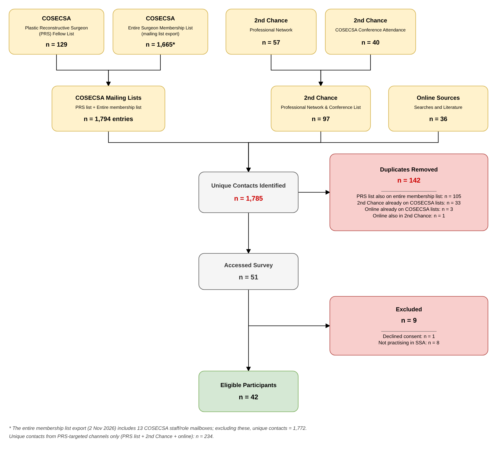

```{r global_chunk-options, echo=FALSE}
knitr::opts_chunk$set(echo = F, message = F, warning = F)
```

```{r initial_setup, include=F}
if(!require("pacman")) install.packages("pacman")

pacman::p_load(here,
               tidyverse, 
               janitor, 
               lubridate, 
               stringr, 
               gt, 
               readxl, 
               purrr, 
               writexl, 
               digest,
               sf,
               countrycode,
               rnaturalearth,
               rnaturalearthdata,
               patchwork,
               scales,
               forcats,
               RColorBrewer,
               tidytext
               )
```

```{r visualization_style, include=FALSE}
# ---- Visualization style ------------------------------------------------------
# Use one sequential palette for quantities and heatmaps, and a consistent
# qualitative palette for distinct groups. Update colors here, not per plot.
viz_sequential <- "YlOrRd"
viz_heat_colors <- c("white", RColorBrewer::brewer.pal(9, viz_sequential))
viz_colors <- c(
  orange_light = "#FEB24C", orange = "#FD8D3C", red = "#BD0026",
  red_light = "#F03B20", dark_red = "#C0392B", green = "#2E8B57",
  grey = "#737373"
)

# Shared color palette for geographic visualizations.
viz_geo_colors <- colorRampPalette(viz_heat_colors)(100)[30:100]

# Common typography/background. Individual figures may override axis choices.
theme_policy <- function(base_size = 12, ...) {
  ggplot2::theme_minimal(base_size = base_size, ...) +
    ggplot2::theme(
      panel.grid.minor = ggplot2::element_blank(),
      plot.title = ggplot2::element_text(face = "bold"),
      plot.title.position = "plot",
      legend.title = ggplot2::element_text(face = "bold")
    )
}
```

```{r dataset_load, include = F}
# Load data (consent and ssa)
df <- read_rds(here("data/clean_data_20261112.rds"))

facility_df <- read_rds(here("data/clean_merged_20261112.rds"))
```

# Report Purpose

This report presents preliminary descriptive findings from the 2nd Chance Survey, examining the demographic characteristics, professional training, geographic distribution, and clinical practice settings of plastic and reconstructive surgeons currently practicing in Sub-Saharan Africa (SSA). The analysis characterizes the surveyed workforce and identifies patterns in professional backgrounds, institutional affiliations, and geographic distribution that may inform further research and workforce planning in the region.

Findings reflect the participating respondents and the facilities they reported and should not be interpreted as representative of the entire plastic and reconstructive surgery workforce in SSA.

# Introduction

## Background

Access to plastic and reconstructive surgery (PRS) remains limited across Sub-Saharan Africa (SSA), despite a substantial burden of trauma, burns, and congenital malformations. Limited specialist availability, uneven workforce distribution, and resource constraints further restrict access to essential reconstructive services. Although surgical workforce assessments have been conducted across the region, comprehensive data on the distribution, practice characteristics, and facility capacity of PRS specialists remain scarce. This information is essential to identify service gaps and inform workforce development and surgical system strengthening.

## Objective

This study aimed to assess the geographic distribution, workforce density, and service delivery capacity of accredited plastic and reconstructive surgeons across SSA. Specifically, it sought to characterize surgeons' practice settings, surgical workload, and the availability of infrastructure, equipment, supplies, and training resources at participating facilities. Methodology

A cross-sectional, multi-country survey was designed to assess PRS workforce and facility capacity across SSA, particularly in countries affiliated with the College of Surgeons of East, Central and Southern Africa (COSECSA) and the West African College of Surgeons (WACS).

A purposive census sampling approach, supplemented by snowball sampling, was used to identify eligible accredited plastic and reconstructive surgeons through professional associations, training institutions, hospitals, and professional networks. Data were collected electronically using a structured questionnaire administered through KoboToolbox. The survey assessed demographic and professional characteristics, geographic distribution, practice settings, surgical workload, facility resources, and training capacity.

Survey responses were de-identified and prepared for analysis using R. Descriptive statistics were used to summarize workforce characteristics and facility capacity. Geographic mapping was used to assess workforce distribution, and surgeon density was calculated per 100,000 population using publicly available population estimates.

## Ethical Considerations

Ethical approval was obtained from the BASEC and CUREG ethics review bodies in Switzerland and the College of Surgeons of East, Central and Southern Africa (COSECSA) Institutional Review Board (IRB) prior to study commencement. Participation was voluntary, and electronic informed consent was obtained before survey completion. The study collected no patient-level information. All survey responses were de-identified and securely stored, with access restricted to authorized research personnel. Findings were reported in aggregate to protect participant and institutional confidentiality.

# Response Rate and Data Completeness

Potential participants were identified through three complementary sources. The COSECSA Entire Surgeon Membership List (n = 1,655) and the COSECSA Plastic Reconstructive Surgeon Fellow List (n = 129) constituted the COSECSA stream. The 2nd Chance Professional Network (n = 57) and 2nd Chance COSECSA Conference Attendance list (n = 40) were merged into a combined list of 97 individuals. Online searches of published literature and other sources identified a further 35 individuals. After deduplication — 33 duplicates from the 2nd Chance stream and 3 from online sources (36 total removed) — these streams yielded 225 unique potential participants (THIS NUMBER IS YET TO BE CONFIRMED WITH COSECSA).

Of the 51 individuals who accessed the survey, 9 were excluded: 1 declined informed consent and 8 were not currently practicing in SSA, leaving 42 eligible participants (82.4% of those who accessed the survey). The response rate relative to the deduplicated pool was 18.7% (42/225).



\-

During data cleaning, one respondent aged 50–59 years reported a specialty accreditation year of 1950, implying 76 years since accreditation — inconsistent with the reported age and not reliably correctable. Both the accreditation year and the derived years-in-practice variable were treated as missing for this individual, who was retained in all other analyses for which valid data were available.

Analyses involving accreditation year therefore have a denominator of N = 41.

# Respondent Characteristics

## Age and Gender

The demographic composition of survey respondents was examined according to age group and gender. Together, these characteristics provide an overview of the age and gender representation within the participating surgical workforce.

### Participant Characteristics

Table 1 summarizes respondents' demographic characteristics and countries of practice. Age, gender, and geographic distributions are reported as frequencies and percentages, with denominators based on available responses for each characteristic.

```{r}
# Section one (header)
.build_section <- function(df, var, section_label, digits = 1,
                           include_na_row = FALSE, na_label = "Not reported/applicable",
                           unit = "respondents") {
  v <- df[[var]]

  # normalize to character; treat blanks as NA
  v_chr <- if (is.factor(v)) as.character(v) else as.character(v)
  v_chr <- ifelse(str_trim(v_chr) == "", NA_character_, v_chr)

  # denominator: non-missing values in this section
  denom <- sum(!is.na(v_chr))

  # counts for non-missing
  items <- tibble(value = v_chr)  %>% 
    filter(!is.na(value)) %>%
    count(value, name = "n") %>%
    arrange(desc(n), value) %>%
    mutate(
      pct = n / denom,
      display = sprintf("%s (%s)", n, percent(pct, accuracy = 10^-digits)),
      row_type = "item",
      label = as.character(value)
    ) %>%
    select(row_type, label, display)

  # optional NA row (excluded from denominator)
  if (include_na_row && any(is.na(v_chr))) {
    na_n <- sum(is.na(v_chr))
    items <- bind_rows(
      items,
      tibble(
        row_type = "item",
        label = na_label,
        display = sprintf("%s (%s)", na_n, percent(na_n / (denom + na_n), accuracy = 10^-digits))
      )
    )
  }

  # section header row
  header <- tibble(
    row_type = "section",
    label    = sprintf("%s, n (%%)", section_label),
    display  = sprintf("N = %s %s", comma(denom), unit)
  )

  bind_rows(header, items)
}

# ----- Build the whole profile table 
make_profile_table_gt <- function(
  df,
  sections = c(
    age_group             = "Age Group",
    gender                = "Gender",
    country_practice      = "Country of Practice"
  ),
  digits = 1,
  include_na_row = FALSE,      # set TRUE if you want an explicit NA row per section
  title = "Participant demographics",# table title (left)
  overall_n_right = TRUE       # show overall N on the far right of the table title
) {
  # assemble all sections (stacked)
  body <- map2_dfr(names(sections), unname(sections), ~
    .build_section(df, var = .x, section_label = .y, digits = digits, include_na_row = include_na_row)
  )

  # little helper for visual indent
  body <- body %>%
    mutate(
      Label = ifelse(row_type == "item", paste0("  ", label), label),
      `n (%)` = display
    ) %>%
    select(Label, `n (%)`, row_type)

  # overall N (optional, in the title area)
  overall_tag <- if (overall_n_right) paste0("N = ", scales::comma(nrow(df)), " respondents") else NULL

  gt_tbl <- body %>%
    gt() %>%
    cols_hide(columns = row_type) %>%
    tab_header(
      title = md(title),
      subtitle = overall_tag
    ) %>%
    # style section header rows
    tab_style(
      style = list(cell_text(weight = "bold")),
      locations = cells_body(rows = row_type == "section", columns = "Label")
    ) %>%
    tab_style(
      style = list(cell_text(weight = "bold"), cell_text(align = "right")),
      locations = cells_body(rows = row_type == "section", columns = "n (%)")
    ) %>%
    # add subtle indentation to item rows
    tab_style(
      style = cell_text(indent = px(12)),
      locations = cells_body(rows = row_type == "item", columns = "Label")
    ) %>%
    # thin row separators between sections
    tab_options(
      table.font.size = px(13),
      data_row.padding = px(6),
      table.border.top.color = "grey70",
      table.border.top.width = px(1),
      table.border.bottom.color = "grey70",
      table.border.bottom.width = px(1)
    ) %>%
    # draw a light rule above each new section
    tab_style(
      style = list(cell_borders(sides = "top", color = "grey85", weight = px(1))),
      locations = cells_body(rows = row_type == "section")
    ) %>%
    cols_label(Label = md(""), `n (%)` = md(""))

  gt_tbl
}

# Make table using gt 
gt_participant_table <- make_profile_table_gt(
  df,
  sections = c(
    # add more or reorder as you like:
    age_group             = "Surgeons (age groups)",
    gender                = "Surgeons by gender",
    country_practice      = "Country of Practice"
  ),
  digits = 1,
  include_na_row = FALSE,
  title = "Participant Characteristics",
  overall_n_right = TRUE
)

gt_participant_table

# # Save Table
#gtsave(gt_table, here("images/gt_participants_characteristics.png"))
```

### Age and Gender Distribution

The combined age and gender distribution is presented in Figure 3. This analysis examines how age groups are represented among male and female respondents, providing additional insight into the demographic composition of participating surgeons.

```{r demo_pyramid, echo=F}
# Calculate counts and percentages by age group and gender
pyramid_data <- df %>%
  filter(
    !is.na(age_group),
    !is.na(gender),
    gender %in% c("Male", "Female")
  ) %>%
  count(age_group, gender, name = "n") %>%
  mutate(
    percentage = 100 * n / sum(n),
    plot_n = if_else(
      gender == "Male",
      -n,
      n
    ),
    pct_label = sprintf("%.1f%%", percentage)
  )

# Create demographic pyramid
demographic_pyramid <- pyramid_data %>%
  ggplot(aes(
    x = age_group,
    y = plot_n,
    fill = gender
  )) +
  geom_col(width = 0.85) +
  geom_text(
    aes(
      label = pct_label,
      hjust = if_else(plot_n < 0, 1.1, -0.1)
    ),
    size = 5,
    show.legend = FALSE
  ) +
  coord_flip() +
  scale_y_continuous(
    labels = function(x) abs(x),
    expand = expansion(mult = 0.15)
  ) +
  scale_fill_manual(
    values = c(
      "Male" = "darkred",
      "Female" = "orange"
    )
  ) +
  labs(
    title = "Age and Gender Distribution of Surgeons",
    x = "Age Group",
    y = "Number of Surgeons",
    fill = "Gender"
  ) +
  theme_minimal(base_size = 20) +
  theme(
    axis.ticks = element_blank(),
    panel.grid.major.y = element_blank(),
    panel.grid.minor = element_blank(),
    legend.position = "top",
    plot.title = element_text(hjust = 0.5)
  )

demographic_pyramid

# Save the graph
# ggsave(filename = here("images/demographic_pyramid.png"), plot = demographic_pyramid, height = 10, width = 13, bg = "white")
```

## Country of Practice

The table below summarizes the geographic distribution of reported countries of practice among respondents, including the frequency and percentage of each country. As respondents could practice in multiple countries, percentages are based on the total number of country mentions.

```{r prep_country_practice, include=F}
# View the countries
# unique(df$country_currently)
# unique(df$country_practice)

# Extract unique countries from each column
clean_country_practice <- df %>% 
  separate_rows(country_currently, sep = ";") %>% 
  mutate(country_currently = str_trim(country_currently))

# Build a vector of valid country names using the countrycode package
valid_countries <- unique(countrycode::codelist$country.name.en)  # Standard country name

# Count respondents by country
country_counts <- clean_country_practice %>% 
  mutate(
    iso_a3 = case_when(
      country_currently == "cote_divoire" ~ "CIV",
      country_currently == "democratic_republic_of_the_congo" ~ "COD",
      TRUE ~ countrycode(
        str_replace_all(country_currently, "_", " "),
        origin = "country.name",
        destination = "iso3c"
      )
    )
  ) %>%
  filter(!is.na(iso_a3)) %>%
  count(country_currently, iso_a3, name = "country_count") %>%
  arrange(desc(country_count))

# Retrieve African country boundaries
africa <- ne_countries(
  continent = "Africa",
  scale = "medium",
  returnclass = "sf"
)

# Join survey counts to map
africa_data <- africa %>%
  left_join(
    country_counts,
    by = c("adm0_a3" = "iso_a3")
  )

```

```{r country_practice_table, echo=FALSE}
# Create table from the choropleth data
country_practice_table <- country_counts %>%
  mutate(
    country = countrycode::countrycode(
      iso_a3,
      origin = "iso3c",
      destination = "country.name"
    )
  ) %>%
  group_by(iso_a3, country) %>%
  summarise(
    n = sum(country_count),
    .groups = "drop"
  ) %>%
  arrange(desc(n), country) %>%
  mutate(
    percentage = 100 * n / sum(n),
    `n (%)` = sprintf("%d (%.1f%%)", n, percentage)
  ) %>%
  select(
    Country = country,
    `Reported practices, n (%)` = `n (%)`
  )

# Format table
country_practice_table %>%
  gt() %>%
  tab_header(
    title = md("**Geographic Distribution of Plastic Surgery Practice**"),
    subtitle = "Reported countries of practice among survey respondents"
  ) %>%
  cols_align(
    align = "left",
    columns = Country
  ) %>%
  cols_align(
    align = "center",
    columns = `Reported practices, n (%)`
  ) %>%
  tab_source_note(
    source_note = md(
      "*Note:* Respondents could report practicing in multiple countries. Percentages are based on the total number of country mentions (N = 43), not unique respondents."
    )
  ) %>%
  opt_row_striping() %>%
  tab_options(
    table.font.size = px(12),
    heading.title.font.size = px(16),
    heading.subtitle.font.size = px(12),
    column_labels.font.weight = "bold"
  )
```

```{r coutry_plot, include=F}
# Calculate total number of country counts
total_n <- sum(country_counts$country_count, na.rm = TRUE)

# Create the count table 
bar_df_top5 <- country_counts %>%
  arrange(desc(country_count), iso_a3) %>%
  slice_head(n = 5) %>%
  mutate(
    percentage  = 100 * country_count / total_n,
    pct_label   = sprintf("%.1f%%", percentage),
    # choose label color based on how dark the bar will be
    label_color = if_else(percentage >= 12, "white", "black")  # tweak threshold if needed
  )

barplot_choro <- bar_df_top5 %>%
  ggplot(aes(
    x = reorder(country_currently, percentage),
    y = percentage, fill = percentage)) +
  geom_col(width = 0.8) +
  # place text just inside the right edge; color varies by bar brightness
  geom_text(aes(label = pct_label, color = label_color),
            hjust = 0.98, vjust = 0.5, size = 3.2, fontface = "bold") +
  scale_fill_gradientn(colors = RColorBrewer::brewer.pal(9, "YlOrRd")) +
  scale_color_identity() +  # use the colors already in the data
  scale_x_discrete(
  labels = stringr::str_to_title) +
  coord_flip(clip = "off") +
  scale_y_continuous(expand = expansion(mult = c(0, 0.02))) +
  labs(title = "Top 5 Contributors to Total PRS") +
  theme_minimal() +
  theme(
    axis.text.x = element_blank(),
    axis.ticks  = element_blank(),
    axis.title  = element_blank(),
    legend.position = "none",
    panel.grid  = element_blank(),
    plot.title.position = "plot",                 # <-- anchor to plot left edge
    plot.title = element_text(size = 12, face = "bold", hjust = 0, margin = margin(b = 6))
  )

barplot_choro
```

```{r choropleth, include=F}
# Plot Africa choropleth
africa_map <- ggplot() +
  # All African countries: white by default
  geom_sf(
    data = africa,
    fill = "white",
    color = "black",
    linewidth = 0.2
  ) +
  # Countries with survey data only
  geom_sf(
    data = africa_data %>% filter(!is.na(country_count)),
    aes(fill = country_count),
    color = "black",
    linewidth = 0.2
  ) +
  # Northern Africa: excluded from the study
  geom_sf(
    data = africa %>% filter(subregion == "Northern Africa"),
    fill = "grey85",
    color = "black",
    linewidth = 0.2
  ) +
  scale_fill_distiller(
    palette = "YlOrRd",
    direction = 1,
    name = "PRS Count",
    breaks = c(1,5,9,13),
    limits = c(1,13)
  ) +
  labs(
    title = "Geographic Distribution of Plastic Surgeons",
    subtitle = "Countries outside SSA are shown in gray"
  ) +
  theme_minimal() +
  theme(
    legend.position = "top",
    axis.text = element_blank(),
    axis.ticks = element_blank(),
    panel.grid = element_blank(),
    plot.title = element_text(face = "bold")
  )

africa_map
```

```{r combine_barpleth, echo=F}
# Combine both barplot with choropleth
combined_choro_bar <-
  africa_map +
  inset_element(barplot_choro,
                left = 0.01,
                bottom = 0.10,
                right = 0.50,
                top = 0.52)

print(combined_choro_bar)

# ggsave(filename = here("images/combined_map_bar.png"),
#        plot = combined_choro_bar,
#        height = 10,
#        width = 13,
#        units = "in")

# ggsave(
#   filename = here::here("images/combined_choro_bar.eps"),
#   plot = combined_choro_bar,
#   height = 10,
#   width = 13,
#   units = "in",
#   dpi = 300,
#   bg = "white",
#   device = "eps"
# )
```

Respondents reported practicing plastic surgery across multiple countries in sub-Saharan Africa (SSA). Ethiopia accounted for the largest proportion of reported countries of practice, with 13 mentions (30.2%), followed by Rwanda with 9 (20.9%), Uganda with 5 (11.6%), and Kenya with 4 (9.3%). Malawi contributed 2 mentions (4.7%). Together, these five countries accounted for 33 of the 43 reported country mentions (76.7%).

The geographic distribution of reported practice locations was concentrated in East Africa, with Ethiopia and Rwanda alone accounting for 51.2% of all country mentions. Because respondents could report practicing in more than one country, these percentages represent the distribution of reported practice locations rather than the proportion of unique respondents. This concentration may reflect the geographic reach of survey recruitment networks, particularly COSECSA, and should not be interpreted as representative of the overall distribution of plastic surgeons or surgical capacity across SSA.

# Professional Training

Professional training characteristics were examined to describe the educational qualifications, accreditation pathways, years since specialty accreditation, and current professional positions of participating surgeons.

## Highest Qualification

```{r qualification, echo=F}
# Calculate qualification
qualification_bar <- df %>% 
  count(qualification) %>% 
# Graph the plot  
  ggplot(aes(
    x = reorder(qualification, -n),
    y = n,
    fill = n
  )) +
  geom_col() +
  geom_text(
    aes(label = paste0("n = ", n)),
    vjust = 1.5,
    size = 3
  ) +
  scale_fill_distiller(palette = "YlOrRd",
                       direction = 1) +
  labs(
    title = "Distribution of Qualification",
    x = "Qualification",
    y = "Number of Surgeons"
  ) +
  theme_minimal() +
  theme(
    axis.ticks = element_blank(),
    axis.title = element_blank(),
    axis.text.x = element_text(angle = 45, hjust = 1),
    legend.position = "none",
    panel.grid = element_blank()
  )

qualification_bar
```

The most common highest qualification was a Fellowship, held by 19 respondents (45.2%), followed by a Membership qualification (12 respondents, 28.6%), a Master's degree in Surgery (7 respondents, 16.7%), a Doctoral or research degree (2 respondents, 4.8%), and a primary medical degree only (2 respondents, 4.8%).

## Primary Accreditation Body

```{r accreditation_barplot, echo=F}
# Calculate accreditation
accreditation_bar <- df %>% 
  count(accreditation_body) %>% 
# Graph the plot  
  ggplot(aes(
    x = reorder(accreditation_body, -n),
    y = n,
    fill = n
  )) +
  geom_col() +
  geom_text(
    aes(label = paste0("n = ", n)),
    vjust = 1.5,
    size = 3
  ) +
  scale_fill_distiller(palette = "YlOrRd",
                       direction = 1) +
  labs(
    title = "Distribution of Accreditation",
    x = "Accreditation",
    y = "Number of Surgeons"
  ) +
  theme_minimal() +
  theme(
    axis.ticks = element_blank(),
    axis.title = element_blank(),
    axis.text.x = element_text(angle = 45, hjust = 1),
    legend.position = "none",
    panel.grid = element_blank()
  )

accreditation_bar
```

COSECSA was the accrediting body for the largest share of respondents: 22 (52.4%) were COSECSA-accredited. National training programmes accredited 14 respondents (33.3%), international training programmes 3 (7.1%), WACS 2 (4.8%), and other bodies 1 (2.4%). The predominance of COSECSA accreditation aligns with the recruitment strategy and geographic concentration of respondents in East and Central Africa.

## Years Since Specialty Accreditation

```{r yrs_practice, echo=F}
# Prep data
practice_df <- df %>% 
  filter(
    !is.na(year_prs_accredited),
    year_prs_accredited >= 0,
    year_prs_accredited < 50
  )

# Calculate median
median_practice <- median(practice_df$year_prs_accredited)

# Create histogram of years in practice
yrs_practice <- practice_df %>% 
  
  ggplot(aes(
    x = year_prs_accredited,
    fill = after_stat(count)
    )) +
    
  # Histogram
  geom_histogram(
    aes(fill = after_stat(count)),
    binwidth = 1,
    boundary = 0,
    color = "white",
    alpha = 0.85
  ) +
    
  # Kernel density curve
  geom_density(
    aes(y = after_stat(density * n * 1)),
    color = "grey",
    linewidth = 0.75,
    adjust = 1,
    fill = NA
  )  +
  
  # Median years
  geom_vline(
  xintercept = median(
   df$year_prs_accredited,
    na.rm = TRUE
  ),
  linetype = "dashed",
  color = "#C0392B",
  linewidth = 0.8
 ) +
    
  # Frequency labels above bars
  geom_text(
  stat = "bin",
  binwidth = 1,
  boundary = 0,
  aes(label = ifelse(
    after_stat(count) > 0,
    paste0("n = ", after_stat(count)),
    "")),
  vjust = -1,
  size = 2.5
  ) +
  scale_fill_distiller(
    palette = "YlOrRd",
    direction = 1
  ) +
  labs(
    title = "Distribution of Years Since Specialty Accreditation",
    x = "Years Since Specialty Accreditation",
    y = "Number of Surgeons",
    caption = paste0(
      "Grey solid curve: kernel density estimate (scaled to frequency). ",
      "Red dashed line: median (",
      round(median_practice, 1),
      " years)."
    )
  ) +
  scale_x_continuous(breaks = seq(0,25, by = 5)) +
  scale_y_continuous(breaks = seq(0,20, by = 5)) +
  theme_minimal() +
  theme(
    axis.title = element_blank(),
    legend.position = "none",
    panel.grid = element_blank(),
    panel.grid.major.y = element_line(color = "grey85", linewidth = 0.4)
  )

yrs_practice

# Save graph
# ggsave(filename = here("images/histo_yrs_practice.png"), plot = yrs_practice,
#                        height = 10, width = 13, bg = "white")
```

```{r yrs_practice_stats, include=F}
# Calcultate summary stats
yrs_practice_stats <- df %>% 
 summarise(
    n = sum(!is.na(x = year_prs_accredited)),
    mean = mean(year_prs_accredited, na.rm = TRUE),
    sd = sd(year_prs_accredited, na.rm = TRUE),
    median = median(year_prs_accredited, na.rm = TRUE),
    q1 = quantile(year_prs_accredited, 0.25, na.rm = TRUE),
    q3 = quantile(year_prs_accredited, 0.75, na.rm = TRUE),
    min = min(year_prs_accredited, na.rm = TRUE),
    max = max(year_prs_accredited, na.rm = TRUE)
  )

yrs_practice_stats
```

```{r box-whisker_plot, include=F}
# Create boxplot of years in practice
yrs_practice_boxplot <- df %>%
  filter(
    !is.na(year_prs_accredited)) %>%
  ggplot(aes(
    x = "",
    y = year_prs_accredited
  )) +
  geom_boxplot(
    fill = "#FD8D3C",       # Orange from YlOrRd palette
    color = "black",
    width = 0.3,
    linewidth = 0.6,
    outlier.color = "#BD0026",
    outlier.size = 2
  ) +
  stat_summary(
    fun = mean,
    geom = "point",
    shape = 18,
    size = 3,
    color = "#BD0026"
  ) +
  labs(
    title = "Distribution of Years in Practice",
    x = NULL,
    y = "Years in Practice"
  ) +
  theme_minimal() +
  theme(
    axis.ticks = element_blank(),
    axis.title = element_blank(),
    axis.text.y = element_text(size = 10),
    axis.text.x = element_blank(),
    legend.position = "none",
    panel.grid = element_blank()
  )

yrs_practice_boxplot

```

The vast majority of respondents — 30 of 41 with valid accreditation data (73.2%) — received specialty accreditation in 2020 or later, confirming the early-career profile of the sample. A further 5 respondents (12.2%) were accredited between 2010 and 2019, and 6 (14.6%) between 2000 and 2009. No respondents reported accreditation before 2000 (the one anomalous 1950 value was excluded as described in the data completeness section).

## Professional Training Background

Table 2 summarizes professional qualifications, accreditation bodies, and periods of specialty accreditation among respondents. These findings characterize the training backgrounds and accreditation histories represented within the surveyed workforce.

```{r professional_table, echo=F}
# Group specialty accreditation years
training_df <- df %>% 
  mutate(
    accreditation_year_group = case_when(
      as.numeric(as.character(accreditation_year)) < 2000 ~ "Pre-2000",
      between(as.numeric(as.character(accreditation_year)), 2000, 2009) ~ "2000-2009",
      between(as.numeric(as.character(accreditation_year)), 2010, 2019) ~ "2010-2019",
      as.numeric(as.character(accreditation_year)) >= 2020 ~ "2020+",
      TRUE ~ NA_character_
    ),
    accreditation_year_group = factor(
      accreditation_year_group,
      levels = c(
        "Pre-2000",
        "2000-2009",
        "2010-2019",
        "2020+"
      )
    )
  )

# Build individual sections
.build_training_section <- function(
  df,
  var,
  section_label,
  digits = 1,
  include_na_row = FALSE
) {

  v <- as.character(df[[var]])
  v <- na_if(str_trim(v), "")

  denom <- sum(!is.na(v))

  items <- tibble(value = v) %>%
  filter(!is.na(value)) %>%
  count(value, name = "N") %>%
  mutate(
    Percent = round(100 * N / denom, digits),
    row_type = "item",
    Label = value
  ) %>%
  select(row_type, Label, N, Percent)

  # Sort accreditation years chronologically
  if (var == "accreditation_year_group") {
    items <- items %>%
      arrange(match(
        Label,
        c("Pre-2000", "2000-2009", "2010-2019", "2020+")
      ))
  } else {
    items <- items %>%
      arrange(desc(N), Label)
  }

  # Optional missing-value row
  if (include_na_row && any(is.na(v))) {
    na_n <- sum(is.na(v))

    items <- bind_rows(
      items,
      tibble(
        row_type = "item",
        Label = "Not reported/applicable",
        N = na_n,
        Percent = round(100 * na_n / length(v), digits)
      )
    )
  }

  header <- tibble(
    row_type = "section",
    Label = section_label,
    N = denom,
    Percent = NA_real_
  )

  bind_rows(header, items)
}


# Build complete professional training table
make_training_table_gt <- function(
  df,
  sections = c(
    qualification = "Highest Qualification",
    accreditation_body = "Primary Accreditation Body",
    accreditation_year_group = "Year of Specialty Accreditation"
  ),
  digits = 1,
  include_na_row = FALSE,
  title = "Professional Training Background"
) {

  body <- map2_dfr(
    names(sections),
    unname(sections),
    ~ .build_training_section(
      df,
      var = .x,
      section_label = .y,
      digits = digits,
      include_na_row = include_na_row
    )
  )

  gt_tbl <- body %>%
    gt() %>%
    cols_hide(columns = row_type) %>%
    tab_header(
      title = md(paste0("**", title, "**")),
      subtitle = paste0(
        "Total sample: N = ",
        scales::comma(nrow(df))
      )
    ) %>%
    cols_label(
      Label = "Characteristic",
      N = "N",
      Percent = "%"
    ) %>%
    fmt_number(
      columns = Percent,
      decimals = digits
    ) %>%
    sub_missing(
      columns = Percent,
      missing_text = ""
    ) %>%
    fmt_number(
      columns = N,
      decimals = 0,
      use_seps = TRUE
    ) %>%
    tab_style(
      style = cell_text(weight = "bold"),
      locations = cells_body(
        rows = row_type == "section"
      )
    ) %>%
    tab_style(
      style = cell_text(indent = px(12)),
      locations = cells_body(
        rows = row_type == "item",
        columns = Label
      )
    ) %>%
    tab_style(
      style = cell_borders(
        sides = "top",
        color = "grey85",
        weight = px(1)
      ),
      locations = cells_body(
        rows = row_type == "section"
      )
    ) %>%
    cols_align(
      align = "right",
      columns = c(N, Percent)
    ) %>%
    tab_options(
      table.font.size = px(13),
      data_row.padding = px(6),
      table.border.top.color = "grey70",
      table.border.top.width = px(1),
      table.border.bottom.color = "grey70",
      table.border.bottom.width = px(1)
    )

  gt_tbl
}

# Make table
gt_training_table <- make_training_table_gt(
  training_df,
  sections = c(
    qualification = "Highest Qualification",
    accreditation_body = "Primary Accreditation Body",
    accreditation_year_group = "Year of Specialty Accreditation"
  ),
  digits = 1,
  include_na_row = FALSE,
  title = "Professional Training Background"
)

gt_training_table

# Save Table
# gtsave(gt_training_table, here("images/gt_training.png"))

```

## Current Professional Position

Consultant/Attending surgeons were the most common position, comprising 16 respondents (38.1%). Residents and trainees accounted for 15 respondents (35.7%), making trainees collectively the second largest group. Academic faculty and Fellows each accounted for 4 respondents (9.5% each), and Department heads/chairs for 3 (7.1%). Taken together, the high proportion of trainees and early-career consultants (38.1% + 35.7% = 73.8%) reinforces the predominantly junior profile identified in the age and accreditation data.

```{r position_table, echo=F}
# -----------------------------------------
# Calculate frequencies and percentages
# -----------------------------------------

valid_n <- sum(!is.na(df$position))

position_summary <- df %>%
  count(position, name = "N", .drop = FALSE) %>%
  mutate(
    Percent = if (valid_n > 0) {
      round(100 * N / valid_n, 1)
    } else {
      NA_real_
    },
    Label = as.character(position)
  ) %>%
  select(Label, N, Percent)

# -----------------------------------------
# Create GT table
# -----------------------------------------

gt_position_table <- position_summary %>%
  gt() %>%

  tab_header(
    title = md("**Current Professional Position**"),
    subtitle = paste0(
      "Total sample: N = ",
      scales::comma(nrow(df))
    )
  ) %>%

  cols_label(
    Label = "Professional Position",
    N = "N",
    Percent = "%"
  ) %>%

  fmt_number(
    columns = N,
    decimals = 0,
    use_seps = TRUE
  ) %>%

  fmt_number(
    columns = Percent,
    decimals = 1
  ) %>%

  sub_missing(
    columns = Percent,
    missing_text = ""
  ) %>%

  cols_align(
    align = "right",
    columns = c(N, Percent)
  ) %>%

  tab_options(
    table.font.size = px(13),
    data_row.padding = px(6),
    table.border.top.color = "grey70",
    table.border.top.width = px(1),
    table.border.bottom.color = "grey70",
    table.border.bottom.width = px(1)
  )

# Display table
gt_position_table

# Save gttable
# gtsave(gt_position_table, here("images/gt_current_professional_position.png"))
```

```{r position_barplot,echo=F}
# Calculate position
position_bar <- df %>% 
  count(position) %>% 
# Graph the plot  
  ggplot(aes(
    x = reorder(position, -n),
    y = n,
    fill = n
  )) +
  geom_col() +
  geom_text(
    aes(label = paste0("n = ", n)),
    vjust = 1.5,
    size = 3
  ) +
  scale_fill_distiller(palette = "YlOrRd",
                       direction = 1) +
  labs(
    title = "Distribution of Position",
    x = "Position",
    y = "Number of Surgeons"
  ) +
  theme_minimal() +
  theme(
    axis.ticks = element_blank(),
    axis.title = element_blank(),
    axis.text.x = element_text(angle = 45, hjust = 1),
    legend.position = "none",
    panel.grid = element_blank()
  )

position_bar
```

## Subspecialty

Respondents could select multiple subspecialties. Reported subspecialties spanned the breadth of plastic and reconstructive surgery, including burn surgery, hand surgery, craniofacial and cleft surgery, microsurgery, aesthetic surgery, and general reconstructive surgery, among others. Because respondents could identify with more than one area, percentages are not expected to total 100% and are reported by subspecialty in the accompanying figures.

```{r factorize_subspecialty, echo=F}
# Extract unique subspecialties from each answer
clean_subspecialty <- df %>% 
  separate_rows(subspecialty, sep = ";") %>% 
  mutate(subspecialty = str_trim(subspecialty))

# Factorize subspecialty
clean_subspecialty <- clean_subspecialty %>% 
  mutate(
    # Clean other
    subspecialty = case_when(
      subspecialty == "other" & subspecialty_other == 1 ~ 
        "general_reconstructive",
      TRUE ~ subspecialty),
    # Factorize subspecialties
    subspecialty = factor(
      subspecialty,
      levels = c("burns", "craniofacial", "hand", "microsurgery", "trauma",
                 "aesthetic", "pediatric", "oncoplastic", "general_reconstructive",
                 "other"),
      labels = c("Burns", "Craniofacial surgery", "Hand surgery", "Microsurgery",
                 "Trauma reconstruction", "Aesthetic plastic surgery", 
                 "Pediatric plastic surgery", "Oncoplastic surgery",
                 "General reconstructive surgery", "Other"))
  )

```

```{r subspeciality_barplot, echo=F}
# Horizontal Bar Chart
subspecialty_bar <- clean_subspecialty %>%

  # Calculate subspecialty frequencies
  count(subspecialty) %>%
  mutate(
    percent = 100 * n / nrow(df)
  ) %>%

  # Graph the plot
  ggplot(aes(
    x = reorder(subspecialty, n),
    y = n,
    fill = n
  )) +

  geom_col() +

  # Add percentage labels inside bars
  geom_text(
    aes(label = paste0(round(percent, 1), "%")),
    hjust = 1.2,
    size = 3.5,
    color = "black"
  ) +

  scale_fill_distiller(
    palette = "YlOrRd",
    direction = 1
  ) +

  # Wrap long subspecialty labels
  scale_x_discrete(
    labels = \(x) stringr::str_wrap(x, width = 15)
  ) +

  coord_flip() +

  labs(
    title = "Distribution of Subspecialty",
    x = "Subspecialty",
    y = "Number of Surgeons",
    caption = paste(
      "Percentages represent the proportion of respondents",
      "selecting each subspecialty. Multiple selections permitted."
    )
  ) +

  theme_minimal() +

  theme(
    axis.ticks = element_blank(),
    axis.title.y = element_blank(),
    axis.title.x = element_text(size = 10),
    axis.text.x = element_text(
      hjust = 0.5,
      vjust = 0.7,
      size = 8
    ),
    legend.position = "none",
    panel.grid = element_blank(),
    panel.grid.major.x = element_line(color = "grey85",linewidth = 0.4),
    plot.caption = element_text(
      size = 9,
      color = "grey40",
      hjust = 0
    )
  )

subspecialty_bar
```

# Practice Settings

Clinical practice settings were examined to characterize the institutions where respondents reported providing surgical services. The analysis considers facility characteristics, institutional ownership, geographic location, and the number of facilities associated with individual surgeons.

Because individual surgeons may practice at multiple institutions and multiple respondents may report the same facility, facility-level and respondent-level findings are presented separately.

## Facilities Reported by Respondents

Survey respondents identified multiple healthcare facilities where they provided clinical services. The frequency with which each facility was reported is summarized in Table 4.

Respondents collectively identified 52 unique healthcare facilities across 12 countries. The University Teaching Hospital of Kigali (CHUK) was the most frequently reported facility, cited by 8 respondents, followed by ALERT Comprehensive Specialized Hospital in Ethiopia (5 respondents) and Yekatit 12 Hospital Medical College in Ethiopia (4 respondents). Rwanda Military Teaching and Referral Hospital was cited by 3 respondents; AIC Kijabe Hospital (Kenya), AaBET Hospital (Ethiopia), Felege Hiwot Hospital (Ethiopia), Mulago National Referral Hospital (Uganda), and Worabe Comprehensive Specialized Hospital (Ethiopia) were each cited by 2 respondents. The remaining 43 facilities were each cited by a single respondent.

```{r echo=F}
# Prepare facility counts
facility_counts <- merged_df %>%
  mutate(facility_name = str_squish(facility_name)) %>%
  filter(!is.na(facility_name), facility_name != "") %>%
  count(facility_name, name = "n") %>%
  arrange(desc(n), facility_name)

# Calculate unique facilities
total_facilities <- nrow(facility_counts)

# Create gt table
facility_table <- facility_counts %>%
  gt() %>%
  tab_header(
    title = md("Facilities Reported by Respondents"),
    subtitle = paste0("N = ", total_facilities, " unique facilities")
  ) %>%
  cols_label(
    facility_name = "Facility Name",
    n = "Respondents, n"
  ) %>%
  cols_align(
    align = "right",
    columns = n
  ) %>%
  tab_options(
    table.font.size = px(13),
    data_row.padding = px(6),
    table.border.top.color = "grey70",
    table.border.top.width = px(1),
    table.border.bottom.color = "grey70",
    table.border.bottom.width = px(1)
  )

facility_table
```

## Facility Characteristics

Reported healthcare facilities differed in geographic setting, institutional level, and ownership structure.

Table 5 summarizes the distribution of unique reported facilities across urban and rural settings, healthcare facility levels, and ownership categories. These characteristics provide context for understanding the institutional environments in which participating surgeons practice.

```{r include=F}
# Create one record per unique facility
facility_level_df <- merged_df %>%
  distinct(
    facility_name,
    .keep_all = TRUE
  )
```

```{r facility_table, echo=F}
# Section one (header)
.build_section <- function(df, var, section_label, digits = 1,
                           include_na_row = FALSE, na_label = "Not reported/applicable") {
  v <- df[[var]]

  # normalize to character; treat blanks as NA
  v_chr <- if (is.factor(v)) as.character(v) else as.character(v)
  v_chr <- ifelse(str_trim(v_chr) == "", NA_character_, v_chr)

  # denominator: non-missing values in this section
  denom <- sum(!is.na(v_chr))

  # counts for non-missing
  items <- tibble(value = v_chr)  %>% 
    filter(!is.na(value)) %>%
    count(value, name = "n") %>%
    arrange(desc(n), value) %>%
    mutate(
      pct = n / denom,
      display = sprintf("%s (%s)", n, percent(pct, accuracy = 10^-digits)),
      row_type = "item",
      label = as.character(value)
    ) %>%
    select(row_type, label, display)

  # optional NA row (excluded from denominator)
  if (include_na_row && any(is.na(v_chr))) {
    na_n <- sum(is.na(v_chr))
    items <- bind_rows(
      items,
      tibble(
        row_type = "item",
        label = na_label,
        display = sprintf("%s (%s)", na_n, percent(na_n / (denom + na_n), accuracy = 10^-digits))
      )
    )
  }

  # section header row
  header <- tibble(
    row_type = "section",
    label    = sprintf("%s, n (%%)", section_label),
    display = sprintf("N = %s facilities", comma(denom))
  )

  bind_rows(header, items)
}

# ----- Build the whole profile table 
make_facility_gt <- function(
  df,
  sections = c(
    facility_location_type             = "Urban vs. Rural",
    facility_level                = "Level of Health Facility",
    facility_ownership      = "Facility Ownership Type"
  ),
  digits = 1,
  include_na_row = FALSE,      # set TRUE if you want an explicit NA row per section
  title = "Facility Characteristics",# table title (left)
  overall_n_right = TRUE       # show overall N on the far right of the table title
) {
  # assemble all sections (stacked)
  body <- map2_dfr(names(sections), unname(sections), ~
    .build_section(df, var = .x, section_label = .y, digits = digits, include_na_row = include_na_row)
  )

  # little helper for visual indent
  body <- body %>%
    mutate(
      Label = ifelse(row_type == "item", paste0("  ", label), label),
      `n (%)` = display
    ) %>%
    select(Label, `n (%)`, row_type)

  # overall N (optional, in the title area)
  overall_tag <- if (overall_n_right) {
  paste0("N = ", scales::comma(nrow(df)), " facilities")
} else {
  NULL
}
  gt_tbl <- body %>%
    gt() %>%
    cols_hide(columns = row_type) %>%
    tab_header(
      title = md(title),
      subtitle = overall_tag
    ) %>%
    # style section header rows
    tab_style(
      style = list(cell_text(weight = "bold")),
      locations = cells_body(rows = row_type == "section", columns = "Label")
    ) %>%
    tab_style(
      style = list(cell_text(weight = "bold"), cell_text(align = "right")),
      locations = cells_body(rows = row_type == "section", columns = "n (%)")
    ) %>%
    # add subtle indentation to item rows
    tab_style(
      style = cell_text(indent = px(12)),
      locations = cells_body(rows = row_type == "item", columns = "Label")
    ) %>%
    # thin row separators between sections
    tab_options(
      table.font.size = px(13),
      data_row.padding = px(6),
      table.border.top.color = "grey70",
      table.border.top.width = px(1),
      table.border.bottom.color = "grey70",
      table.border.bottom.width = px(1)
    ) %>%
    # draw a light rule above each new section
    tab_style(
      style = list(cell_borders(sides = "top", color = "grey85", weight = px(1))),
      locations = cells_body(rows = row_type == "section")
    ) %>%
    cols_label(Label = md(""), `n (%)` = md(""))

  gt_tbl
}

# Make table using gt 
gt_table <- make_facility_gt(
  facility_level_df,
  sections = c(
    facility_location_type = "Urban vs. Rural",
    facility_level = "Level of Health Facility",
    facility_ownership = "Facility Ownership Type"
  ),
  digits = 1,
  include_na_row = FALSE,
  title = "Facility Characteristics",
  overall_n_right = TRUE
)

gt_table

# # Save Table
#gtsave(gt_table, here("images/gt_participants_characteristics.png"))
```

## Facility Distribution by level and Ownership

The distribution of facility ownership across healthcare facility levels is presented in Figure 10.

This analysis examines the composition of reported institutions according to their level within the healthcare system and ownership structure, allowing comparison of institutional categories within the surveyed facilities.

```{r facility_barplot, echo=F}
# COunt unique facilities by level and ownership
facility_count <- merged_df %>% 
  distinct(
    facility_name,
    facility_level,
    facility_ownership
  ) %>%
  count(
    facility_level,
    facility_ownership,
    name = "n"
  ) %>%
  group_by(facility_level) %>%
  mutate(
    percentage = 100 * n / sum(n),
    pct_label = sprintf("%.1f%%", percentage)
  ) %>%
  ungroup()

# Total unique facilities
total_facility_n <- merged_df %>%
  distinct(facility_name) %>%
  nrow()

# Graph barplot
facility_bar <- facility_count %>%
  ggplot(aes(
    x = facility_level,
    y = n,
    fill = facility_ownership
  )) +
  geom_col(
    position = "stack",
    width = 0.7
  ) +
  geom_text(
    aes(label = pct_label),
    position = position_stack(vjust = 0.5),
    size = 3,
    color = "black"
  ) +
  scale_color_identity() +
  scale_fill_brewer(
    palette = "YlOrRd",
    direction = 1
  ) +
  scale_x_discrete(
    limits = c(
      "district",
      "provincial",
      "central",
      "university",
      "central university",
      "provincial central",
      "provincial university"
    )
  ) +
  scale_y_continuous(
    breaks = breaks_width(2)
  ) +
  labs(
    title = "Facility Distribution by Level and Ownership Type",
    subtitle = paste("Total unique facilities:", total_facility_n),
    x = "Facility Level",
    y = "Number of Facilities"
  ) +
  theme_minimal() +
  theme(
    plot.title = element_text(
      face = "bold",
      size = 13
    ),
    axis.text.x = element_text(
      angle = 0,
      hjust = 0.5
    ),
    axis.ticks = element_blank(),
    panel.grid.major.x = element_blank(),
    panel.grid.minor = element_blank(),
    legend.title = element_text(face = "bold"),
    legend.position = "inside",
    legend.position.inside = c(0.98, 0.98),
    legend.justification = c(1, 1),
    legend.background = element_rect(
      fill = "white",
      color = NA
    )
  )

facility_bar

```

Reported facilities spanned multiple levels of the health system. Central hospitals accounted for 12 facilities (23.1%), provincial hospitals for 11 (21.2%), and university hospitals for 11 (21.2%). District hospitals contributed 9 facilities (17.3%), central-university combined hospitals 7 (13.5%), and provincial-central and provincial-university combined hospitals 1 each (1.9%).

Public facilities were the most common ownership type (18 facilities, 34.6%), closely followed by private facilities (17, 32.7%). Quasi-governmental facilities accounted for 6 (11.5%), NGO-operated facilities for 5 (9.6%), mission hospitals for 3 (5.8%), military hospitals for 2 (3.8%), and other ownership types for 1 (1.9%). The near-parity between public and private facilities signals that plastic surgery services in SSA are delivered through a mixed-ownership landscape.

## Urban vs. Rural Facility Distribution by Country

The great majority of reported facilities were urban: 45 of 52 (86.5%), with only 7 (13.5%) classified as rural. This urban predominance was consistent across countries, suggesting that plastic surgery services are concentrated in city-based hospitals throughout the region.

```{r urban_rural_barplot, echo=F}
# Count facility and percentages
facility_country_count <- merged_df %>% 
  distinct(
    facility_country,
    facility_name, 
    facility_location_type
  ) %>% 
  count(
    facility_country,
    facility_location_type,
    name = "n"
  ) %>% 
  group_by(facility_country) %>% 
  mutate(
    percentage = 100 * n / sum(n),
    pct_label = sprintf("%.1f%%", percentage),
    label = if_else(percentage >= 5, pct_label, "")
  ) %>% 
  ungroup()

# Total number of unique facilities
total_facility_n <- merged_df %>%
  distinct(facility_country, facility_name) %>%
  nrow()

# Create stacked bar
facility_location_bar <- facility_country_count %>%
  ggplot(aes(
    x = facility_country,
    y = n,
    fill = facility_location_type
  )) +
  geom_col(
    position = "fill",
    width = 0.7
  ) +
  geom_text(
    aes(label = label),
    position = position_fill(vjust = 0.5),
    size = 3,
    color = "black"
  ) +
  scale_fill_manual(
    values = c(
      "urban" = "#FEB24C",  # Orange-yellow
      "rural" = "#F03B20"   # Red-orange
    ),
    name = "Facility Location",
    breaks = c("urban", "rural"),
    labels = c("Urban", "Rural")
) +
  scale_y_continuous(
    labels = scales::percent,
    breaks = seq(0, 1, by = 0.2),
    expand = expansion(mult = c(0, 0))
  ) +
  labs(
    title = "Urban vs. Rural Facility Distribution by Country",
    subtitle = paste(
      "Total unique facilities:", total_facility_n
    ),
    x = "Country",
    y = "Percentage of Facilities"
  ) +
  theme_minimal() +
  theme(
    plot.title = element_text(
      face = "bold",
      size = 13
    ),
    axis.ticks = element_blank(),
    axis.text.x = element_text(
      angle = 0,
      hjust = 0.5
    ),
    panel.grid.major.x = element_blank(),
    panel.grid.minor = element_blank(),
    legend.position = "top",
    legend.justification = "right",
    legend.title = element_text(face = "bold")
  )

facility_location_bar
```

## Multiple Facilities

Survey respondents reported different patterns of institutional affiliation, including practice at a single facility and practice across multiple facilities.

The proportion of respondents reporting employment or clinical activity at more than one facility is presented in Figure 12.

### Number of Operating Facilities

The distribution of the number of facilities associated with individual respondents is presented in Figure 13.

These results describe the extent to which participating surgeons practice across multiple healthcare institutions and provide additional context for interpreting facility-level reporting within the survey.

```{r facilities_plot, echo=F}
# Visualize number of facilities
facility <- df %>% 
  count(multiple_facilities) %>% 
# Graph the plot  
  ggplot(aes(
    x = reorder(multiple_facilities, -n),
    y = n,
    fill = n
  )) +
  geom_col() +
  geom_text(
    aes(label = paste0("n = ", n)),
    vjust = 1.5,
    size = 3
  ) +
  scale_fill_distiller(palette = "YlOrRd",
                       direction = 1) +
  labs(
    title = "Operate in Multiple Facilities?",
    x = "Yes or No",
    y = "Number of Surgeons"
  ) +
  theme_minimal() +
  theme(
    axis.ticks = element_blank(),
    axis.title = element_blank(),
    axis.text.x = element_text(angle = 45, hjust = 1),
    legend.position = "none",
    panel.grid = element_blank()
  )
  
facility
```

```{r multiple_facilities, echo=F}
# Count multiple facilities
multiple_facilities <- df %>% 
  mutate(num_facilities = if_else(
    multiple_facilities == "no", 
    1,
    num_facilities
  )
)

# Create barplot for multiple facilities
num_facility <- df %>%
  filter(!is.na(num_facilities)) %>%
  count(num_facilities) %>%
  ggplot(aes(
    x = factor(num_facilities),
    y = n,
    fill = n
  )) +
  geom_col(
    width = 0.7,
    color = "white"
  ) +
  geom_text(
    aes(label = paste0("n = ", n)),
    vjust = -0.5,
    size = 2.5
  ) +
  scale_fill_distiller(
    palette = "YlOrRd",
    direction = 1
  ) +
  labs(
    title = "Distribution of Number of Facilities",
    x = "Number of Servicing Facilities",
    y = "Number of Surgeons"
  ) +
  scale_y_continuous(
    breaks = scales::breaks_width(5),
    expand = expansion(mult = c(0, 0.1))
  ) +
  theme_minimal() +
  theme(
    axis.title = element_blank(),
    legend.position = "none",
    panel.grid = element_blank(),
    panel.grid.major.y = element_line(
      color = "grey85",
      linewidth = 0.4
    )
  )

num_facility
```

A proportion of respondents reported practicing at more than one facility. The number of facilities per respondent is detailed in the accompanying figures. Practice across multiple institutions increases the aggregate service reach of individual surgeons but may also reflect fragmented or cross-subsidised service delivery — a pattern worth exploring in subsequent analyses.

# Workforce Profile

A proportion of respondents reported practicing at more than one facility. The number of facilities per respondent is detailed in the accompanying figures. Practice across multiple institutions increases the aggregate service reach of individual surgeons but may also reflect fragmented or cross-subsidised service delivery — a pattern worth exploring in subsequent analyses. Workforce Profile and Staffing Respondents provided staffing estimates — plastic and reconstructive surgeons (PRS), PRS trainees, operating theatre (OT) nurses, and physiotherapists — for each of their reported facilities. Where multiple respondents reported the same facility, values are presented as median (minimum–maximum) to account for variation in individual estimates; single-respondent facilities report the value directly.

## Staffing Numbers per Facility

Staffing numbers varied substantially across facilities and countries. Among the most heavily staffed facilities: - Saint Paul's Hospital Millennium Medical College (Ethiopia): 10 PRS surgeons, 17 PRS trainees, 20 OT nurses, 3 physiotherapists — the largest reported PRS surgeon count across all facilities. - Kenyatta National Hospital (Kenya): 5 PRS surgeons, 25 PRS trainees, 15 OT nurses, 4 physiotherapists — notable for the high trainee-to-surgeon ratio of 5:1. - King Faisal Hospital (Rwanda): 2 PRS surgeons, 25 PRS trainees, 10 OT nurses, 2 physiotherapists — the highest reported trainee count of any single facility. - ALERT Comprehensive Specialized Hospital (Ethiopia): median 8 PRS surgeons (range 7–9), 13 trainees (10–26), 24 OT nurses (16–30), 6 physiotherapists (5–10), based on 5 respondents. - Yekatit 12 Hospital Medical College (Ethiopia): median 5 PRS surgeons (5–7), 23 trainees (13–30), 12.5 OT nurses (10–15), 4.5 physiotherapists (3–6), based on 4 respondents. - University Teaching Hospital of Kigali — CHUK (Rwanda): median 1 PRS surgeon (1–4), 12.5 trainees (5–25), 3 OT nurses (2–10), 1 physiotherapist (0–2), based on 8 respondents — the most-reported facility, but with a notably low median PRS surgeon count.

Several facilities — including Nkinga Referral Hospital (Tanzania), Kalembelembe Pediatric Hospital (DR Congo), CHR Notsé (Togo), and Kalkaal Hospital (Somalia) — reported zero PRS surgeons, with either trainees only or minimal allied health support, suggesting severely limited specialist capacity. Staffing counts were not independently verified and represent self-reported estimates.

```{r staffing_table, echo=F}
# Create function
format_staffing <- function(x) {

  # Remove missing values
  x <- x[!is.na(x)]

  # If all values are missing
  if (length(x) == 0) return("NR")

  # If only one respondent reported a value
  if (length(x) == 1) {
    return(as.character(x))
  }

  # If multiple respondents reported values
  median_value <- median(x)
  min_value <- min(x)
  max_value <- max(x)

  # If all respondents agree, show only the value
  if (min_value == max_value) {
    return(as.character(median_value))
  }

  # Otherwise, show median (minimum–maximum)
  paste0(
    median_value,
    " (", min_value, "–", max_value, ")"
  )
}

# Facility-level staffing summary
facility_staffing <- merged_df %>%
  group_by(facility_country, facility_name) %>%
  summarise(
    n_respondents = n(),

    prs_surgeons = format_staffing(num_prs_surgeons),
    prs_trainees = format_staffing(num_prs_trainees),
    ot_nurses = format_staffing(num_ot_nurses),
    physiotherapists = format_staffing(num_physiotherapists),

    .groups = "drop"
  ) %>%
  arrange(facility_country, facility_name)

# Create table grouped by country
facility_staffing %>%
  gt(groupname_col = "facility_country") %>%
  cols_label(
    facility_name = "Facility",
    n_respondents = "Respondents (n)",
    prs_surgeons = "PRS surgeons",
    prs_trainees = "PRS trainees",
    ot_nurses = "OT nurses",
    physiotherapists = "Physiotherapists"
  ) %>%
  tab_header(
    title = "Reported Surgical Workforce by Facility and Country",
    subtitle = "Facility-level workforce estimates"
  ) %>%
  cols_align(
    align = "center",
    columns = -facility_name
  ) %>%
  tab_style(
    style = cell_text(weight = "bold"),
    locations = cells_row_groups()
  ) %>%
  tab_options(
    table.font.size = px(12),
    data_row.padding = px(5),
    row_group.font.weight = "bold",
    column_labels.font.weight = "bold"
  ) %>%
  tab_source_note(
    source_note = paste(
      "For facilities with multiple valid reports,",
      "values represent median (minimum–maximum).",
      "For facilities with one valid report,",
      "the reported count is shown directly.",
      "Staffing counts were not independently verified."
    )
  )
```

# Service Delivery

## Scope of Procedures Performed

```{r heatmap, include=F}
# Create list of variables
procedure_vars <- names(df)[84:101]

response_levels <- c(
  "routinely",
  "occasionally",
  "rarely",
  "not_performed"
)

# Custom procedure labels
procedure_labels <- c(
  "wound_debridement"     = "Wound Debridement",
  "skin_lesion_excision"  = "Skin Lesion Excision",
  "burn_excision"         = "Burn Excision",
  "burn_reconstruction"   = "Burn Reconstruction",
  "contracture_release"   = "Contracture Release",
  "skin_substitute_app"   = "Skin Substitute Application",
  "stsg"                  = "Split-Thickness Skin Graft",
  "ftsg"                  = "Full-Thickness Skin Graft",
  "local_pedicled_flaps"  = "Local/Pedicled Flaps",
  "microvascular_surgery" = "Microvascular Surgery",
  "hand_surgery_proc"     = "Hand Surgery Procedures",
  "tendon_repair"         = "Tendon Repair",
  "amputation"            = "Amputation",
  "cleft_lip_repair"      = "Cleft Lip Repair",
  "cleft_palate_repair"   = "Cleft Palate Repair",
  "craniofacial_recon"    = "Craniofacial Reconstruction",
  "breast_reconstruction" = "Breast Reconstruction",
  "cosmetic_surgery"      = "Cosmetic Surgery"
)

service_long <- df %>%
  select(all_of(procedure_vars)) %>%
  pivot_longer(
    cols = everything(),
    names_to = "procedure",
    values_to = "frequency"
  ) %>%
  mutate(
    frequency = str_squish(as.character(frequency)),
    frequency = case_when(
      str_to_lower(frequency) == "performed occasionally" ~
        "Occasionally performed",
      TRUE ~ frequency
    ),
    frequency = factor(
      frequency,
      levels = response_levels
    )
  )

```

```{r calculate_heatmap, include=F}
# Calculate the heatmap percentages
heatmap_data <- service_long %>%
  filter(!is.na(frequency)) %>%
  count(procedure, frequency, name = "n") %>%
  complete(
    procedure,
    frequency = factor(
      response_levels,
      levels = response_levels
    ),
    fill = list(n = 0)
  ) %>%
  group_by(procedure) %>%
  mutate(
    total = sum(n),
    percent = if_else(
      total > 0,
      100 * n / total,
      NA_real_
    )
  ) %>%
  ungroup()

# Order procedures by % routinely performed
procedure_order <- heatmap_data %>%
  filter(frequency == "routinely") %>%
  arrange(desc(percent)) %>%
  pull(procedure)

heatmap_data <- heatmap_data %>%
  mutate(
    procedure = factor(
      procedure,
      levels = rev(procedure_order)
    )
  )


```

```{r create_heatmap, echo=F}
# Create heatmap
ggplot(heatmap_data, aes(x = frequency, y = procedure, fill = percent)) +
  geom_tile(color = "white", linewidth = 0.7) +
  geom_text(aes(
    label = sprintf("%.1f%%", percent),
    color = case_when(percent == 0 ~ "grey50", 
                      percent >= 50 ~ "white", 
                      TRUE ~ "black")
  ),
  size = 3.5,
  show.legend = FALSE) +
  scale_color_identity() +
  scale_fill_gradientn(
    colours = viz_heat_colors,
    limits = c(0, 100),
    breaks = c(0, 25, 50, 75, 100),
    labels = function(x)
      paste0(x, "%"),
    name = "Respondents (%)"
  ) +
  scale_x_discrete(labels = c("Routinely", "Occasionally", "Rarely", "Not performed")) +
  labs(
    title = "Scope of Procedures Performed",
    subtitle = "Distribution of surgeon-reported procedural frequency",
    x = NULL,
    y = NULL,
    caption = paste(
      "Percentages calculated from valid responses",
      "for each procedure."
    )
  ) +
  
  scale_y_discrete(
    labels = function(x) {
      dplyr::coalesce(unname(procedure_labels[x]), x)
    }
  ) +
  theme_policy(base_size = 12) +
  theme(
    panel.grid = element_blank(),
    axis.text.x = element_text(size = 10, face = "bold"),
    axis.text.y = element_text(size = 10),
    plot.title = element_text(face = "bold"),
    legend.position = "none"
  )

```

## Workload

```{r prepare_workload, include=F}
# Prepare workload categories

# Total surgeons with valid workload responses
total_respondents <- df %>%
  filter(
    !is.na(workload_categories),
    str_trim(as.character(workload_categories)) != ""
  ) %>%
  nrow()

# Separate multiple selections into individual rows
workload_df <- df %>%
  mutate(
    respondent_id = row_number(),
    workload_categories = as.character(workload_categories)
  ) %>%
  filter(
    !is.na(workload_categories),
    str_trim(workload_categories) != ""
  ) %>%
  separate_rows(
    workload_categories,
    sep = ";"
  ) %>%
  mutate(
    workload_categories = str_trim(workload_categories)
  ) %>%
  filter(
    workload_categories != "",
    !is.na(workload_categories)
  ) %>%
  # Count each category once per surgeon
  distinct(respondent_id, workload_categories)

# Calculate frequencies and percentages
workload_count <- workload_df %>%
  count(
    workload_categories,
    name = "n"
  ) %>%
  arrange(desc(n), workload_categories) %>%
  mutate(
    percentage = 100 * n / total_respondents,

    # Highlight the 3 most frequently selected categories
    rank = row_number(),

    highlight = if_else(
      rank <= 3,
      "Top 3 Categories",
      "Other Categories"
    ),

    # Label with frequency and percentage
    pct_label = sprintf(
      "%.1f%% (n = %s)",
      percentage,
      n
    )
  )

# View the summary
workload_count

```

```{r histogram_workload, echo=F}
# Most Common Reconstructive Workload

workload_bar <- workload_count %>%
  ggplot(
    aes(
      x = reorder(workload_categories, percentage),
      y = percentage,
      fill = percentage
    )
  ) +

  # Horizontal bars
  geom_col(
    width = 0.75
  ) +

  # Percentage and frequency labels
  geom_text(
    aes(label = pct_label),
    hjust = -0.1,
    size = 3.5,
    color = "black"
  ) +

  # Continuous color gradient based on percentage
  scale_fill_distiller(
    palette = viz_sequential,
    direction = 1
  ) +

  # Format category names
  scale_x_discrete(
    labels = function(x) {
      stringr::str_wrap(
        stringr::str_to_sentence(
          stringr::str_replace_all(x, "_", " ")
        ),
        width = 30
      )
    }
  ) +

  # Percentage axis
  scale_y_continuous(
    limits = c(
      0,
      max(workload_count$percentage) * 1.25
    ),
    breaks = scales::breaks_width(10),
    labels = scales::label_number(suffix = "%")
  ) +

  # Horizontal orientation
  coord_flip(clip = "off") +

  labs(
    title = "Most Common Reconstructive Workload Categories",
    subtitle = paste0(
      "Top 3 workload categories reported by surgeons (N = ",
      total_respondents,
      ")"
    ),
    x = NULL,
    y = "% of respondents selecting as top 3",
    caption = paste(
      "Respondents could select up to three categories.",
      "Percentages may exceed 100% when summed."
    )
  ) +

  theme_policy() +

  theme(
    plot.title = element_text(
      face = "bold",
      size = 13
    ),
    axis.ticks = element_blank(),
    axis.title.y = element_blank(),
    panel.grid.major.y = element_blank(),
    panel.grid.minor = element_blank(),
    legend.position = "none",
    plot.caption = element_text(
      size = 9,
      color = "grey40",
      hjust = 0
    ),
    plot.margin = margin(10, 45, 10, 10)
  )

# Display figure
workload_bar

```

```{r setup_eq_infra, include=F}

# Standardize keys without changing the analysis source files.
# iconv removes invalid bytes; inspect country labels after import if needed.
clean_text <- function(x) {
  x <- iconv(as.character(x), from = "", to = "UTF-8", sub = "")
  stringr::str_squish(x)
}

# Shared counts/labels and response levels used by both domains.
availability_levels <- c("consistently", "intermittently", "not_available")
infra_response_levels <- availability_levels
eq_response_levels <- availability_levels

infrastructure_labels <- c(
  infra_electricity = "Electricity", infra_water = "Running Water",
  infra_oxygen = "Oxygen Supply", infra_blood_bank = "Blood Bank",
  infra_icu = "Intensive Care Unit (ICU)",
  infra_physio = "Physiotherapy Services",
  infra_ot_therapy = "Occupational Therapy Services",
  infra_histopath = "Histopathology Services", infra_xray = "X-Ray",
  infra_ultrasound = "Ultrasound", infra_ct = "CT Scanner",
  infra_dedicated_or = "Dedicated Operating Room Time for PRS",
  infra_temp_or = "Temperature-Controlled Operating Room",
  infra_warming = "Patient Warming Devices"
)

equipment_labels <- c(
  eq_dermatome = "Dermatome/Humby Knife", eq_skin_mesher = "Skin Mesher",
  eq_burn_dressings = "Burn Dressings", eq_skin_substitutes = "Skin Substitutes",
  eq_npwt = "Negative Pressure Wound Therapy (VAC)",
  eq_electrosurgical = "Electrosurgical Unit",
  eq_sterilization = "Sterilization Equipment",
  eq_anesthesia = "Functional Anesthesia Machine",
  eq_ventilator = "Mechanical Ventilator",
  eq_pulse_oximeter = "Pulse Oximeter", eq_loupes = "Surgical Loupes",
  eq_microsurgical = "Microsurgical Instruments",
  eq_microscope = "Operating Microscope",
  eq_sutures = "Fine Monofilament Sutures", eq_iv_fluids = "IV Fluids",
  eq_catheters = "Urinary Catheters", eq_tourniquets = "Tourniquets",
  eq_splinting = "Splinting Materials"
)

equipment_groups <- c(
  eq_burn_dressings = "Essential", eq_electrosurgical = "Essential",
  eq_sterilization = "Essential", eq_anesthesia = "Essential",
  eq_pulse_oximeter = "Essential", eq_sutures = "Essential",
  eq_iv_fluids = "Essential", eq_catheters = "Essential",
  eq_tourniquets = "Essential", eq_splinting = "Essential",
  eq_dermatome = "PRS-specific", eq_skin_mesher = "PRS-specific",
  eq_loupes = "PRS-specific", eq_microsurgical = "PRS-specific",
  eq_microscope = "Advanced", eq_npwt = "Advanced",
  eq_skin_substitutes = "Advanced", eq_ventilator = "Advanced"
)

equipment_classification <- tibble(
  item = names(equipment_groups),
  group = factor(unname(equipment_groups),
                 levels = c("Essential", "PRS-specific", "Advanced"))
)

# Extract column names before aggregating or scoring data.
infra_names <- names(dplyr::select(df, starts_with("infra_")))
eq_names <- names(dplyr::select(df, starts_with("eq_")))
if (!length(infra_names) || !length(eq_names)) {
  stop("Infrastructure or equipment columns could not be found in df.")
}
if (length(setdiff(eq_names, names(equipment_groups)))) {
  stop("Equipment items missing group assignments: ",
       paste(setdiff(eq_names, names(equipment_groups)), collapse = ", "))
}
if (length(setdiff(infra_names, names(infrastructure_labels))) ||
    length(setdiff(eq_names, names(equipment_labels)))) {
  warning("Some infrastructure/equipment labels are missing; raw names will be used.")
}
```

```{r helper-functions, include=FALSE}
# ---- 1. Reusable functions (defined before any data transformations) --------

# Aggregate surgeon responses to one facility-by-item modal response.
# A tie is recorded as no_consensus; missing answers are not counted.
aggregate_facility_availability <- function(data, variables,
                                            facility_var = "main_facility_name") {
  required <- c(facility_var, variables)
  if (!all(required %in% names(data))) {
    stop("Missing columns: ", paste(setdiff(required, names(data)), collapse = ", "))
  }
  long_data <- data %>%
    mutate(facility_name = clean_text(.data[[facility_var]])) %>%
    filter(!is.na(facility_name), facility_name != "") %>%
    select(facility_name, all_of(variables)) %>%
    pivot_longer(cols = all_of(variables), names_to = "item",
                 values_to = "frequency") %>%
    mutate(frequency = clean_text(frequency),
           frequency = str_replace_all(str_to_lower(frequency), "\\s+", "_"),
           frequency = na_if(frequency, ""))
  unknown <- setdiff(unique(na.omit(long_data$frequency)), availability_levels)
  if (length(unknown)) {
    stop("Unexpected availability responses: ", paste(unknown, collapse = ", "))
  }
  long_data %>%
    filter(!is.na(frequency)) %>%
    count(facility_name, item, frequency, name = "n") %>%
    group_by(facility_name, item) %>%
    summarise(
      n_surgeons = sum(n),
      agreement_pct = 100 * max(n) / sum(n),
      availability = if (sum(n == max(n)) == 1L) {
        frequency[which.max(n)]
      } else {
        "no_consensus"
      },
      .groups = "drop"
    )
}

# Transform categorical respondent responses to percentages within each item.
calculate_respondent_heatmap <- function(data, item_names, item_col) {
  data %>%
    select(all_of(item_names)) %>%
    pivot_longer(cols = everything(), names_to = item_col,
                 values_to = "frequency") %>%
    mutate(frequency = str_replace_all(str_to_lower(clean_text(frequency)),
                                       "\\s+", "_"),
           frequency = if_else(frequency %in% availability_levels,
                               frequency, NA_character_),
           frequency = factor(frequency, levels = availability_levels)) %>%
    filter(!is.na(frequency)) %>%
    count(.data[[item_col]], frequency, name = "n") %>%
    complete(!!rlang::sym(item_col),
             frequency = factor(availability_levels, levels = availability_levels),
             fill = list(n = 0)) %>%
    group_by(.data[[item_col]]) %>%
    mutate(total = sum(n), percent = if_else(total > 0, 100 * n / total, NA_real_)) %>%
    ungroup()
}

# Make an item-by-frequency heatmap (works for respondents or facilities).
plot_availability_heatmap <- function(data, item_var, labels, title, subtitle,
                                      denominator_label = "Respondents") {
  item_order <- data %>%
    filter(frequency == "consistently") %>%
    arrange(desc(percent)) %>% pull(.data[[item_var]]) %>% as.character()
  plot_data <- data %>%
    mutate(.item = factor(as.character(.data[[item_var]]), levels = rev(item_order)))
  ggplot(plot_data, aes(x = frequency, y = .item, fill = percent)) +
    geom_tile(color = "white", linewidth = 0.7) +
    geom_text(aes(label = if_else(is.na(percent), "NR", sprintf("%.1f%%", percent)),
                  color = case_when(is.na(percent) | percent == 0 ~ "grey50",
                                    percent >= 50 ~ "white", TRUE ~ "black")),
              size = 3.4, show.legend = FALSE) +
    scale_color_identity() +
    scale_fill_gradientn(colors = viz_heat_colors, limits = c(0, 100),
                         breaks = c(0, 25, 50, 75, 100),
                         labels = function(x) paste0(x, "%"),
                         name = paste0(denominator_label, " (%)"),
                         na.value = "grey90") +
    scale_x_discrete(labels = c(consistently = "Consistently",
                                intermittently = "Intermittently",
                                not_available = "Not Available")) +
    scale_y_discrete(labels = function(x) {
      str_wrap(coalesce(unname(labels[x]), x), 40)
    }) +
    labs(title = title, subtitle = subtitle, x = NULL, y = NULL,
         caption = paste0("Percentages based on valid responses/classifications per item. ",
                          "NR = no valid classifications.")) +
    theme_policy(12) +
    theme(panel.grid = element_blank(),
          axis.text.x = element_text(size = 10, face = "bold"),
          axis.text.y = element_text(size = 10), legend.position = "none")
}

# Summarize classified facility responses for a single item (no duplicate rows).
calculate_facility_heatmap <- function(facility_data, item_names) {
  facility_data %>%
    filter(item %in% item_names, availability %in% availability_levels) %>%
    mutate(frequency = factor(availability, levels = availability_levels)) %>%
    count(item, frequency, name = "n") %>%
    complete(item = item_names,
             frequency = factor(availability_levels, levels = availability_levels),
             fill = list(n = 0)) %>%
    group_by(item) %>%
    mutate(total = sum(n), percent = if_else(total > 0, 100 * n / total, NA_real_)) %>%
    ungroup()
}

# Calculate share of facilities that classify each equipment item consistently.
calculate_equipment_availability <- function(data, country_name = NULL) {
  if (!is.null(country_name)) data <- filter(data, facility_country == country_name)
  if (!nrow(data)) stop("No equipment data for the requested group.")
  item_summary <- data %>%
    filter(item %in% equipment_classification$item) %>%
    group_by(item) %>%
    summarise(
      n_facilities = n_distinct(facility_name[availability %in% availability_levels]),
      n_consistently = n_distinct(facility_name[availability == "consistently"]),
      .groups = "drop"
    )
  equipment_classification %>%
    left_join(item_summary, by = "item") %>%
    mutate(n_facilities = replace_na(n_facilities, 0L),
           n_consistently = replace_na(n_consistently, 0L),
           percent = if_else(n_facilities > 0, 100 * n_consistently / n_facilities,
                             NA_real_),
           pct_label = if_else(is.na(percent), "NR",
                               sprintf("%.1f%% (%s/%s)", percent,
                                       n_consistently, n_facilities)))
}

# Draw consistent grouped equipment charts for overall and country results.
plot_equipment_availability <- function(equipment_data, title, subtitle) {
  item_levels <- equipment_data %>% arrange(group, desc(percent), item) %>% pull(item)
  plot_data <- equipment_data %>%
    mutate(item = factor(item, levels = rev(item_levels)))
  ggplot(plot_data, aes(x = percent, y = item, fill = percent)) +
    geom_col(width = 0.75, na.rm = TRUE) +
    geom_text(aes(x = if_else(is.na(percent), 2, percent + 2), label = pct_label),
              hjust = 0, size = 3.2) +
    scale_fill_gradientn(colors = viz_geo_colors, limits = c(0, 100)) +
    scale_x_continuous(breaks = seq(0, 100, 20),
                       labels = scales::label_number(suffix = "%")) +
    coord_cartesian(xlim = c(0, 125), clip = "off") +
    scale_y_discrete(labels = function(x) {
      str_wrap(coalesce(unname(equipment_labels[x]), x), 35)
    }) +
    facet_grid(rows = vars(group), scales = "free_y", space = "free_y", switch = "y") +
    labs(title = title, subtitle = subtitle,
         x = "Facilities with Consistent Availability (%)", y = NULL, fill = NULL,
         caption = paste("Facility classifications based on modal surgeon responses.",
                         "Percentages use valid unambiguous item classifications;",
                         "NR = no valid classifications; labels show % (n/N).")) +
    theme_policy(12) +
    theme(axis.ticks = element_blank(), panel.grid.major.y = element_blank(),
          panel.grid.minor = element_blank(),
          strip.text.y.left = element_text(face = "bold"),
          strip.placement = "outside", legend.position = "none",
          plot.margin = margin(10, 45, 10, 10))
}

# Create a reusable Cleveland dot plot for equipment availability.
plot_equipment_dotplot <- function(
    equipment_data,
    title = "Availability of Surgical Equipment and Supplies",
    subtitle = NULL,
    label_width = 32,
    max_dot_size = 9
) {

  # Check that the required columns are present.
  required_vars <- c("item", "group", "percent")

  if (!all(required_vars %in% names(equipment_data))) {
    stop(
      "Missing required columns: ",
      paste(
        setdiff(required_vars, names(equipment_data)),
        collapse = ", "
      )
    )
  }

  # Define the category order and colors.
  category_colors <- c(
    "Essential" = viz_colors[["orange_light"]],
    "PRS-specific" = viz_colors[["orange"]],
    "Advanced" = viz_colors[["red"]]
  )

  # Prepare equipment labels and plotting order.
  plot_data <- equipment_data %>%
    mutate(
      group = factor(
        as.character(group),
        levels = names(category_colors)
      ),

      equipment_label = dplyr::coalesce(
        unname(equipment_labels[as.character(item)]),
        as.character(item)
      ),

      equipment_label = stringr::str_wrap(
        equipment_label,
        width = label_width
      )
    ) %>%
    arrange(group, percent, item) %>%
    mutate(
      equipment_label = factor(
        equipment_label,
        levels = unique(equipment_label)
      )
    )

  # Construct the Cleveland dot plot.
  ggplot(
    plot_data,
    aes(
      x = percent,
      y = equipment_label
    )
  ) +

    # Add percentage reference lines.
    geom_vline(
      xintercept = seq(0, 100, 25),
      color = "grey90",
      linewidth = 0.4
    ) +

    # Larger dots indicate higher percentages.
    geom_point(
      aes(
        color = group,
        size = percent
      ),
      alpha = 0.9,
      na.rm = TRUE
    ) +

    # Display percentages to the right of the dots.
    geom_text(
      data = function(x) {
        dplyr::filter(x, !is.na(percent))
      },
      aes(
        label = sprintf("%.1f%%", percent)
      ),
      nudge_x = 3,
      hjust = 0,
      size = 3,
      color = "black"
    ) +

    # Apply consistent equipment category colors.
    scale_color_manual(
      values = category_colors,
      breaks = names(category_colors),
      drop = FALSE,
      name = "Equipment Category"
    ) +

    # Keep dot sizing consistent across all country plots.
    scale_size_area(
      max_size = max_dot_size,
      limits = c(0, 100),
      breaks = c(25, 50, 75, 100)
    ) +

    # Separate equipment groups without showing side labels.
    facet_grid(
      group ~ .,
      scales = "free_y",
      space = "free_y",
      drop = FALSE
    ) +

    # Format percentage axis.
    scale_x_continuous(
      breaks = seq(0, 100, 25),
      labels = scales::label_number(suffix = "%")
    ) +

    # Allow space for percentage annotations.
    coord_cartesian(
      xlim = c(0, 120),
      clip = "off"
    ) +

    # Add graph titles and methodological notes.
    labs(
      title = title,
      subtitle = subtitle,
      x = "Facilities with Consistent Availability (%)",
      y = NULL,
      caption = paste(
        "Availability based on facility-level modal surgeon responses.",
        "Percentages use valid classifications for each equipment item.",
        "Dot size represents consistent availability.",
        "NR = no valid classifications."
      )
    ) +

    # Apply the established visualization theme.
    theme_policy(base_size = 12) +

    theme(
      axis.ticks = element_blank(),
      panel.grid = element_blank(),
      axis.text.y = element_text(size = 10),

      # Remove facet/category text on the side.
      strip.text.y = element_blank(),
      strip.background = element_blank(),

      # Show the equipment category legend at the bottom.
      legend.position = "bottom",
      legend.direction = "horizontal",
      legend.title = element_text(
        size = 10,
        face = "bold"
      ),
      legend.text = element_text(size = 9),

      plot.caption = element_text(
        size = 9,
        color = "grey40",
        hjust = 0
      ),

      plot.margin = margin(10, 45, 10, 10)
    ) +

    # Keep category colors in the legend, but hide size legend.
    guides(
      color = guide_legend(
        title = "Equipment Category",
        override.aes = list(size = 5)
      ),
      size = "none"
    )
}

# Convert facility availability counts to diverging bar plotting data.
make_gap_plot_data <- function(summary_data, item_order = NULL) {
  if (is.null(item_order)) {
    item_order <- summary_data %>%
      filter(availability == "not_available") %>%
      arrange(desc(percent), item) %>% pull(item)
  }
  summary_data %>%
    filter(availability %in% c("not_available", "consistently")) %>%
    mutate(plot_percent = if_else(availability == "not_available", -percent, percent),
           availability_label = if_else(availability == "not_available",
                                        "Not Available", "Consistently Available"),
           pct_label = if_else(is.na(percent), "NR",
                               sprintf("%.1f%% (%s/%s)", percent, n, total)),
           item = factor(item, levels = rev(item_order)))
}

# Reusable diverging plot for overall and per-country infrastructure gaps.
plot_infra_gap <- function(data, title, subtitle) {
  ggplot(data, aes(x = plot_percent, y = item, fill = availability_label)) +
    geom_col(width = 0.7, position = "identity", na.rm = TRUE) +
    geom_text(data = function(x) filter(x, !is.na(plot_percent)),
              aes(label = pct_label,
                  hjust = if_else(availability_label == "Not Available", 1.08, -0.08)),
              size = 3.1) +
    geom_vline(xintercept = 0, color = "grey40", linewidth = 0.6) +
    scale_fill_manual(values = c("Not Available" = viz_colors[["dark_red"]],
                                 "Consistently Available" = viz_colors[["green"]])) +
    scale_x_continuous(breaks = seq(-100, 100, 25),
                       labels = function(x) paste0(abs(x), "%")) +
    coord_cartesian(xlim = c(-125, 125), clip = "off") +
    scale_y_discrete(labels = function(x) {
      str_wrap(coalesce(unname(infrastructure_labels[x]), x), 35)
    }, drop = FALSE) +
    labs(title = title, subtitle = subtitle, x = "Percentage of Facilities",
         y = NULL, fill = NULL,
         caption = paste("Facility-level modal surgeon responses.",
                         "Intermittent availability remains in denominators but is not shown.",
                         "Missing and tied responses excluded; labels show % (n/N).")) +
    theme_policy(12) +
    theme(axis.ticks = element_blank(), panel.grid.major.y = element_blank(),
          panel.grid.minor = element_blank(), legend.position = "top",
          plot.margin = margin(10, 40, 10, 10))
}
```

```{r prepare-shared-data, include=FALSE}
# ---- 2. Shared inputs and facility-country lookup ---------------------------
# This chunk runs BEFORE readiness, country gaps, equipment, and figures.

# Validate keys before joining, including multiple country assignments.
facility_country_lookup <- facility_df %>%
  transmute(facility_name = clean_text(facility_name),
            facility_country = na_if(clean_text(facility_country), "")) %>%
  filter(!is.na(facility_name), facility_name != "") %>% distinct()
country_conflicts <- facility_country_lookup %>%
  group_by(facility_name) %>%
  summarise(n_countries = n_distinct(facility_country, na.rm = TRUE), .groups = "drop") %>%
  filter(n_countries > 1)
if (nrow(country_conflicts)) stop("Facility names map to multiple countries: ",
                                  paste(country_conflicts$facility_name, collapse = ", "))
facility_country_lookup <- facility_country_lookup %>%
  arrange(facility_name, is.na(facility_country)) %>%
  distinct(facility_name, .keep_all = TRUE)

# Calculate facility classifications once (do NOT redefine these later).
infra_facility_summary <- aggregate_facility_availability(df, infra_names)
eq_facility_summary    <- aggregate_facility_availability(df, eq_names)
infra_facility_country <- infra_facility_summary %>%
  left_join(facility_country_lookup, by = "facility_name", relationship = "many-to-one")
eq_facility_country <- eq_facility_summary %>%
  left_join(facility_country_lookup, by = "facility_name", relationship = "many-to-one")

# Country lists get domain-specific names to avoid accidental overwriting.
infra_countries <- sort(unique(na.omit(infra_facility_country$facility_country)))
eq_countries <- sort(unique(na.omit(eq_facility_country$facility_country)))

# Respondent-level heatmap data (different denominator from facility-level data).
infra_heatmap_data <- calculate_respondent_heatmap(df, infra_names, "infrastructure")
eq_heatmap_data <- calculate_respondent_heatmap(df, eq_names, "equipment")

# Facility-level heatmaps (valid modal classifications only).
infra_facility_heatmap_data <- calculate_facility_heatmap(infra_facility_summary, infra_names)
eq_facility_heatmap_data <- calculate_facility_heatmap(eq_facility_summary, eq_names)

# Diagnostic: unmatched facilities remain excluded from country comparisons.
unmatched_infrastructure_facilities <- infra_facility_country %>%
  filter(is.na(facility_country)) %>% distinct(facility_name)
unmatched_equipment_facilities <- eq_facility_country %>%
  filter(is.na(facility_country)) %>% distinct(facility_name)
```

```{r calculate-infrastructure, include=FALSE}
# ---- 3. Infrastructure calculations (before any infrastructure graphs) -----

# Make an explicit facility-by-item grid to retain missing classifications.
# This prevents missing items from being silently treated as zero availability.
infra_scores_long <- infra_facility_country %>%
  filter(!is.na(facility_country), facility_country != "") %>%
  transmute(facility_name, facility_country, item,
            readiness_point = case_when(availability == "consistently" ~ 2L,
                                        availability == "intermittently" ~ 1L,
                                        availability == "not_available" ~ 0L,
                                        TRUE ~ NA_integer_)) %>%
  group_by(facility_name, facility_country) %>%
  complete(item = infra_names) %>% ungroup()

infra_readiness_facility <- infra_scores_long %>%
  group_by(facility_name, facility_country) %>%
  summarise(n_consistently = sum(readiness_point == 2L, na.rm = TRUE),
            n_classified = sum(!is.na(readiness_point)),
            n_missing = length(infra_names) - n_classified,
            readiness_score = if (n_classified == length(infra_names)) {
              sum(readiness_point)
            } else NA_real_,
            .groups = "drop")

infra_readiness_country <- infra_readiness_facility %>%
  group_by(facility_country) %>%
  summarise(n_facilities = sum(!is.na(readiness_score)),
            n_incomplete = sum(is.na(readiness_score)),
            mean_score = if (all(is.na(readiness_score))) NA_real_ else
              mean(readiness_score, na.rm = TRUE),
            sd_score = sd(readiness_score, na.rm = TRUE),
            .groups = "drop") %>%
  mutate(se = sd_score / sqrt(n_facilities),
         t_value = if_else(n_facilities >= 2,
                           qt(0.975, df = pmax(n_facilities - 1, 1)), NA_real_),
         ci_lower = pmax(0, mean_score - t_value * se),
         ci_upper = pmin(2 * length(infra_names), mean_score + t_value * se)) %>%
  filter(n_facilities > 0) %>% arrange(desc(mean_score))

# Percentage of infrastructure classified consistently at each complete facility.
infra_consistency_facility <- infra_scores_long %>%
  group_by(facility_country, facility_name) %>%
  summarise(n_classified = sum(!is.na(readiness_point)),
            n_consistently = sum(readiness_point == 2L, na.rm = TRUE),
            .groups = "drop") %>%
  filter(n_classified == length(infra_names)) %>%
  mutate(pct_consistently = 100 * n_consistently / length(infra_names))

infra_consistency_country <- infra_consistency_facility %>%
  group_by(facility_country) %>%
  summarise(n_facilities = n(), mean_pct = mean(pct_consistently),
            .groups = "drop") %>% arrange(desc(mean_pct))

# Item availability among facilities with a valid classification for that item.
infra_valid <- infra_facility_country %>%
  filter(!is.na(facility_country), facility_country != "",
         item %in% infra_names, availability %in% availability_levels)
all_infra_countries <- infra_countries
infra_country_heatmap <- infra_valid %>%
  count(facility_country, item, availability, name = "n") %>%
  group_by(facility_country, item) %>%
  summarise(n_facilities = sum(n),
            n_consistently = sum(n[availability == "consistently"]),
            .groups = "drop") %>%
  complete(facility_country = all_infra_countries, item = infra_names,
           fill = list(n_facilities = 0L, n_consistently = 0L)) %>%
  mutate(percent = if_else(n_facilities > 0,
                           100 * n_consistently / n_facilities, NA_real_),
         cell_label = if_else(is.na(percent), "NR",
                              sprintf("%.1f%%\n(%s/%s)", percent,
                                      n_consistently, n_facilities)))

# Order country heatmap columns by mean classified facility consistency.
country_order <- infra_valid %>%
  group_by(facility_country, facility_name) %>%
  summarise(pct_consistently = 100 * mean(availability == "consistently"),
            .groups = "drop") %>%
  group_by(facility_country) %>%
  summarise(mean_pct = mean(pct_consistently), .groups = "drop") %>%
  arrange(desc(mean_pct)) %>% pull(facility_country)
country_order <- c(country_order, setdiff(all_infra_countries, country_order))

infra_item_order <- infra_valid %>%
  group_by(item) %>%
  summarise(percent = 100 * mean(availability == "consistently"),
            .groups = "drop") %>%
  arrange(desc(percent)) %>% pull(item)
infra_item_order <- c(infra_item_order, setdiff(infra_names, infra_item_order))
infra_country_heatmap <- infra_country_heatmap %>%
  mutate(facility_country = factor(facility_country, levels = country_order),
         item = factor(item, levels = rev(infra_item_order)))

# Overall and country-specific diverging gap data reuse the same denominator rule.
infra_gap_data <- infra_facility_summary %>%
  filter(item %in% infra_names, availability %in% availability_levels) %>%
  count(item, availability, name = "n") %>%
  complete(item = infra_names, availability = availability_levels,
           fill = list(n = 0)) %>%
  group_by(item) %>%
  mutate(total = sum(n), percent = if_else(total > 0, 100 * n / total, NA_real_)) %>%
  ungroup()
infra_diverging_data <- make_gap_plot_data(infra_gap_data)

infra_country_gap_data <- infra_facility_country %>%
  filter(!is.na(facility_country), facility_country != "",
         item %in% infra_names, availability %in% availability_levels) %>%
  count(facility_country, item, availability, name = "n") %>%
  complete(nesting(facility_country), item = infra_names,
           availability = availability_levels, fill = list(n = 0)) %>%
  group_by(facility_country, item) %>%
  mutate(total = sum(n), percent = if_else(total > 0, 100 * n / total, NA_real_)) %>%
  ungroup()
```

```{r calculate-equipment, include=FALSE}
# ---- 4. Equipment calculations (before any equipment graphs) ---------------
equipment_overall_data <- calculate_equipment_availability(eq_facility_country)
eq_overall_n_facilities <- n_distinct(eq_facility_country$facility_name, na.rm = TRUE)

# Precalculate country tables once, then reuse in per-country plotting function.
equipment_country_data <- setNames(
  lapply(eq_countries, function(ctry) {
    calculate_equipment_availability(eq_facility_country, ctry)
  }), eq_countries
)
```

# INFRASTRUCTURE

## Availability: Surgeon-reported heatmap

```{r infrastructure-respondent-heatmap, fig.height=7}
infra_respondent_heatmap <- plot_availability_heatmap(
  infra_heatmap_data, "infrastructure", infrastructure_labels,
  "Infrastructure Available",
  "Distribution of surgeon-reported infrastructure frequency",
  "Respondents"
)
infra_respondent_heatmap
```

## Consistently Available Infrastructure

```{r infrastructure-consistency-country, fig.height=7}
infra_consistency_bar <- infra_consistency_country %>%
  mutate(country_label = paste0(facility_country, " (n = ", n_facilities, ")")) %>%
  ggplot(aes(x = reorder(country_label, mean_pct), y = mean_pct, fill = mean_pct)) +
  geom_col(width = 0.75) +
  geom_text(aes(label = sprintf("%.1f%%", mean_pct)), hjust = -0.15, size = 3.5) +
  scale_fill_gradientn(colors = viz_geo_colors, limits = c(0, 100)) +
  scale_y_continuous(breaks = seq(0, 100, 20),
                     labels = scales::label_number(suffix = "%")) +
  coord_flip(ylim = c(0, 105), clip = "off") +
  labs(title = "Consistently Available Infrastructure by Country",
       subtitle = "Mean percentage of assessed items consistently available at complete facilities",
       x = NULL, y = "Consistently available (%)",
       caption = paste("Facility-level modal surgeon responses; complete facility classifications only.",
                       "n = number of facilities.")) +
  theme_policy(12) +
  theme(axis.ticks = element_blank(), panel.grid.major.y = element_blank(),
        legend.position = "none", plot.margin = margin(10, 50, 10, 10))
infra_consistency_bar
```

## Heatmap by Country and Infrastructure

```{r infrastructure-country-heatmap, fig.width=13, fig.height=9}
infra_country_heatmap_plot <- ggplot(
  infra_country_heatmap,
  aes(x = facility_country, y = item, fill = percent)
) +
  geom_tile(color = "white", linewidth = 0.7) +
  geom_text(aes(label = cell_label,
                color = case_when(is.na(percent) | percent == 0 ~ "grey50",
                                  percent >= 50 ~ "white", TRUE ~ "black")),
            size = 2.7, lineheight = 0.9, show.legend = FALSE) +
  scale_color_identity() +
  scale_fill_gradientn(colors = viz_heat_colors, limits = c(0, 100),
                       breaks = seq(0, 100, 25),
                       labels = function(x) paste0(x, "%"),
                       name = "Facilities (%)", na.value = "grey90") +
  scale_x_discrete(labels = function(x) str_to_title(str_replace_all(x, "_", " ")),
                   drop = FALSE) +
  scale_y_discrete(labels = function(x) {
    str_wrap(coalesce(unname(infrastructure_labels[x]), x), 35)
  }, drop = FALSE) +
  labs(title = "Consistent Infrastructure Availability by Country",
       subtitle = "Percentage of classified facilities reporting consistent item availability",
       x = NULL, y = NULL,
       caption = paste("Cell labels: percentage (n/N) among valid facility-level classifications.",
                       "NR = no valid classifications. Country samples vary.")) +
  theme_policy(12) +
  theme(axis.text.x = element_text(angle = 45, hjust = 1, size = 9),
        axis.ticks = element_blank(), panel.grid = element_blank(),
        legend.position = "none")

infra_country_heatmap_plot
```

## Critical Infrastructure Gaps

```{r infrastructure-critical-gaps, fig.height=9}
infra_gap_plot <- plot_infra_gap(
  infra_diverging_data,
  "Critical Infrastructure Gaps",
  "Consistently available versus unavailable infrastructure across surveyed facilities"
)
infra_gap_plot
```

# EQUIPMENT

## Availability: Surgeon-reported heatmap

```{r equipment-respondent-heatmap, fig.height=8}
eq_respondent_heatmap <- plot_availability_heatmap(
  eq_heatmap_data, "equipment", equipment_labels,
  "Equipment Available", "Distribution of surgeon-reported equipment frequency",
  "Respondents"
)
eq_respondent_heatmap
```

## Facility-level Equipment: Essential vs. Specialized

```{r equipment_overall_dotplot, fig.width=11, fig.height=9, echo=FALSE}
# Create the overall equipment availability Cleveland dot plot.
equipment_dotplot <- plot_equipment_dotplot(
  equipment_data = equipment_overall_data,
  title = "Availability of Surgical Equipment and Supplies",
  subtitle = sprintf(
    "Consistent availability across surveyed facilities (N = %s)",
    eq_overall_n_facilities
  )
)

# Display the overall figure.
equipment_dotplot
```

# FACILITY-LEVEL AVAILABILITY HEATMAPS

## Infrastructure at Facility Level

```{r infrastructure-facility-heatmap, fig.height=8}

infra_facility_heatmap <- plot_availability_heatmap(
  infra_facility_heatmap_data, "item", infrastructure_labels,
  "Infrastructure Availability Across Facilities",
  "Based on most commonly reported surgeon response per facility/item",
  "Facilities")

infra_facility_heatmap
```

## Equipment at Facility Level

```{r equipment-facility-heatmap, fig.height=9}

equipment_facility_heatmap <- plot_availability_heatmap(
  eq_facility_heatmap_data, "item", equipment_labels,
  "Equipment Availability Across Facilities",
  "Based on most commonly reported surgeon response per facility/item",
  "Facilities"
)

equipment_facility_heatmap
```

# TRAINING

## Training Capacity at Facilities

```{r}
# SECTION 8 — TRAINING CAPACITY AND NEEDS


# ------------------------------------------------------------
# Helper: Repair country-name encoding
# ------------------------------------------------------------

clean_country_encoding <- function(x) {

  # Convert to character without applying string operations.
  x <- as.character(x)

  # Repair invalid UTF-8 bytes.
  # Try conversion from UTF-8 first, then Windows-1252
  # for strings that could not be decoded.
  repaired <- iconv(
    x,
    from = "UTF-8",
    to = "UTF-8",
    sub = NA_character_
  )

  # Identify strings that failed conversion.
  failed <- is.na(repaired) & !is.na(x)

  if (any(failed)) {
    repaired[failed] <- iconv(
      x[failed],
      from = "CP1252",
      to = "UTF-8",
      sub = "byte"
    )
  }

  # Standardize Côte d'Ivoire to an ASCII representation.
  # This avoids differing apostrophe encodings during joins.
  repaired <- ifelse(
    grepl("ivoire", repaired, ignore.case = TRUE),
    "Cote d'Ivoire",
    repaired
  )

  # Remove extra whitespace after encoding repair.
  repaired <- stringr::str_squish(repaired)

  return(repaired)
}

# 1. Training variables
training_vars <- c(
  "trains_residents",
  "hosts_outreach",
  "cpd_available"
)

training_labels <- c(
  "trains_residents" = "Trains PRS Residents/Fellows",
  "hosts_outreach" = "Hosts Visiting Outreach Teams",
  "cpd_available" = "Continuing Professional Development Opportunities Available"
)


# ------------------------------------------------------------
# Create facility characteristics lookup
# ------------------------------------------------------------

facility_training_lookup <- facility_df %>%
  transmute(
    # Standardize facility names.
    facility_name = stringr::str_squish(
      as.character(facility_name)
    ),

    # Repair invalid country-name encodings.
    facility_country = clean_country_encoding(
      facility_country
    ),

    # Standardize facility levels.
    facility_level = stringr::str_squish(
      as.character(facility_level)
    )
  ) %>%

  # Remove records without a facility name.
  filter(
    !is.na(facility_name),
    facility_name != ""
  ) %>%

  # Convert empty values into missing values.
  mutate(
    facility_country = na_if(facility_country, ""),
    facility_level = na_if(facility_level, "")
  ) %>%

  # Keep one consistent set of characteristics per facility.
  group_by(facility_name) %>%
  summarise(
    across(
      c(facility_country, facility_level),
      ~ {
        values <- unique(.x[!is.na(.x)])

        if (length(values) > 1) {
          stop(
            "Conflicting facility characteristics found."
          )
        }

        if (length(values) == 0) {
          NA_character_
        } else {
          values[1]
        }
      }
    ),
    .groups = "drop"
  )

# Display the facility characteristics lookup.
facility_training_lookup

# 3. Convert surgeon training responses to long format
training_long <- df %>%
  mutate(
    facility_name = str_squish(
      as.character(main_facility_name)
    )
  ) %>%
  filter(
    !is.na(facility_name),
    facility_name != ""
  ) %>%
  select(
    facility_name,
    all_of(training_vars)
  ) %>%
  pivot_longer(
    cols = all_of(training_vars),
    names_to = "training_indicator",
    values_to = "response"
  ) %>%
  mutate(
    response = str_to_lower(
      str_squish(as.character(response))
    ),
    response = na_if(response, ""),
    response = if_else(
      response %in% c("yes", "no"),
      response,
      NA_character_
    )
  )


# 4. Aggregate surgeon responses by facility
training_facility <- training_long %>%
  filter(!is.na(response)) %>%
  count(
    facility_name,
    training_indicator,
    response,
    name = "n"
  ) %>%
  group_by(
    facility_name,
    training_indicator
  ) %>%
  summarise(
    n_surgeons = sum(n),

    agreement_pct = 100 * max(n) / sum(n),

    availability = if (
      sum(n == max(n)) == 1
    ) {
      response[which.max(n)]
    } else {
      "no_consensus"
    },

    .groups = "drop"
  ) %>%
  left_join(
    facility_training_lookup,
    by = "facility_name",
    relationship = "many-to-one"
  )

# View facility-level responses
training_facility
```

```{r}
# TRAINING CAPACITY AT FACILITIES
# Overall and country-specific training capacity.
# Section headings show the number of unique facilities.

# 1. Function to summarize training capacity.
summarise_training_capacity <- function(
    data,
    section_label
) {

  # Count unique facilities represented in this section.
  section_n <- data %>%
    filter(
      !is.na(facility_name),
      facility_name != ""
    ) %>%
    summarise(
      n = n_distinct(facility_name)
    ) %>%
    pull(n)

  # Add facility count to the section heading.
  section_heading <- sprintf(
    "%s (N = %s facilities)",
    section_label,
    scales::comma(section_n)
  )

  # Summarize each training indicator.
  data %>%
    group_by(training_indicator) %>%
    summarise(
      yes_n = sum(availability == "yes", na.rm = TRUE),
      no_n = sum(availability == "no", na.rm = TRUE),
      total = yes_n + no_n,
      .groups = "drop"
    ) %>%
    right_join(
      tibble(training_indicator = training_vars),
      by = "training_indicator"
    ) %>%
    mutate(
      across(
        c(yes_n, no_n, total),
        ~ tidyr::replace_na(.x, 0L)
      ),

      Section = section_heading,

      Indicator = unname(
        training_labels[training_indicator]
      ),

      `Yes N (%)` = if_else(
        total > 0,
        sprintf(
          "%s (%.1f%%)",
          yes_n,
          100 * yes_n / pmax(total, 1)
        ),
        "NR"
      ),

      `No N (%)` = if_else(
        total > 0,
        sprintf(
          "%s (%.1f%%)",
          no_n,
          100 * no_n / pmax(total, 1)
        ),
        "NR"
      )
    ) %>%
    select(
      Section,
      Indicator,
      `Yes N (%)`,
      `No N (%)`
    )
}


# 2. Calculate overall training capacity.
training_overall <- summarise_training_capacity(
  data = training_facility,
  section_label = "Overall"
)


# 3. Calculate training capacity by country.
training_by_country <- training_facility %>%
  filter(
    !is.na(facility_country),
    facility_country != ""
  ) %>%
  group_split(facility_country) %>%
  purrr::map_dfr(function(x) {

    summarise_training_capacity(
      data = x,
      section_label = paste0(
        "Country: ",
        unique(x$facility_country)[1]
      )
    )
  })


# 4. Combine overall and country-specific sections.
training_table_data <- bind_rows(
  training_overall,
  training_by_country
)


# 5. Create the formatted gt table.
gt_training_capacity <- training_table_data %>%
  gt(
    rowname_col = "Indicator",
    groupname_col = "Section"
  ) %>%

  # Add table title and subtitle.
  tab_header(
    title = md("**Training Capacity at Facilities**"),
    subtitle = "Overall and by country"
  ) %>%

  # Bold section headings.
  tab_style(
    style = cell_text(weight = "bold"),
    locations = cells_row_groups()
  ) %>%

  # Align response counts and percentages.
  cols_align(
    align = "right",
    columns = c(
      `Yes N (%)`,
      `No N (%)`
    )
  ) %>%

  # Apply consistent table styling.
  tab_options(
    table.font.size = px(13),
    data_row.padding = px(6),
    row_group.background.color = "#F2F4F6",
    table.border.top.color = "grey70",
    table.border.bottom.color = "grey70"
  ) %>%

  # Explain denominators and missing data.
  tab_source_note(
    source_note = md(
      paste(
        "N represents the number of unique facilities",
        "in each section.",
        "Percentages are calculated separately for each",
        "training indicator using valid, unambiguous",
        "facility classifications.",
        "Tied and missing responses are excluded",
        "from indicator-specific denominators.",
        "NR = no valid classified facilities."
      )
    )
  )

# 6. Display the training capacity table.
gt_training_capacity

```
